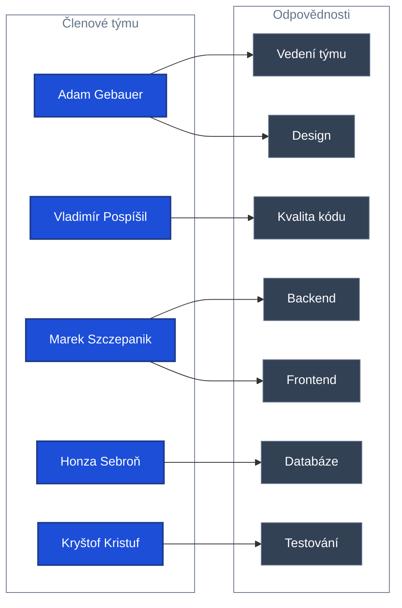

# 🌊 StudentFlow

- Systém pro správu studentských týmových projektů.

## 👥 Tým

### Název týmu

- Kulíšci ♥

### Členové týmu a jejich responsibilita

> [!CAUTION]
> Všichni členové týmu si navzájem poskytují podporu. Vedoucí pozice slouží především k rozdělení odpovědností, koordinaci příslušných oblastí a jejich smysl. Neznamenají výhradní odpovědnost za danou oblast ani omezení zapojení ostatních členů týmu.

## 📚 Dokumentace

| FÁZE I - INCEPTION | FÁZE II - ELABORATION |
| :--- | :--- |
| [Vize projektu](documents/INCEPTION/VIZE_PROJEKTU.md) | [Návrh architektury](documents/ELABORATION/ARCHITECTURAL_DESIGN.md) |
| [Popis problému](documents/INCEPTION/PROBLEM_DESCRIPTION.md) | [Technologický návrh](documents/ELABORATION/TECHNOLOGICAL_DESIGN.md) |
| [Stakeholděři](documents/INCEPTION/STAKEHOLDERS.md) |  |
| [Risk-list – seznam rizik](documents/INCEPTION/RISK_LIST.md) |  |
| [Rozsah projektu – Scope](documents/INCEPTION/SCOPE_OF_PROJECT.md) |  |
| [Cíle projektu](documents/INCEPTION/PROJECT_OBJECTIVES.md) |  |
| [Use Case – případy užití](documents/INCEPTION/USE_CASE.md) |  |
| [Požadavky systému](documents/INCEPTION/REQUIREMENTS.md) |  |
| [Kandidát architektury](documents/INCEPTION/Kandidat-architektury.png) |  |

