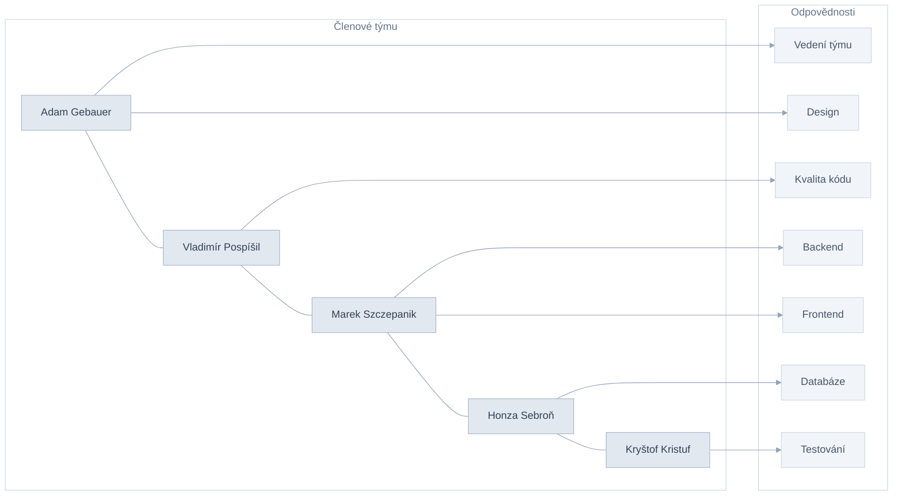

# 🌊 StudentFlow

- Systém pro správu studentských týmových projektů.

## 👥 Tým

### Název týmu

- Kulíšci ♥

### Členové týmu a jejich responsibilita

> [!CAUTION]
> Všichni členové týmu si navzájem poskytují podporu. Vedoucí pozice slouží především k rozdělení odpovědností, koordinaci příslušných oblastí a jejich smysl. Neznamenají výhradní odpovědnost za danou oblast ani omezení zapojení ostatních členů týmu.

## 📚 Dokumentace

Dokumentace postupuje podle zadání předmětu: **problém → vize → uživatelé → požadavky → případy užití → návrh → architektura → prototyp**. Každý dokument uvádí, na který předchozí navazuje.

| FÁZE I - INCEPTION | FÁZE II - ELABORATION |
| :--- | :--- |
| [Popis problému](documents/INCEPTION/PROBLEM_DESCRIPTION.md) | [Wireframy](documents/ELABORATION/Wireframe.pdf) |
| [Vize projektu](documents/INCEPTION/VIZE_PROJEKTU.md) | [ER model](documents/ELABORATION/StudentFlow_ER.svg) |
| [Rozsah projektu – Scope](documents/INCEPTION/SCOPE_OF_PROJECT.md) | [Autentizace – API a doplňky wireframů](documents/ELABORATION/auth/README.md) |
| [Cíle projektu](documents/INCEPTION/PROJECT_OBJECTIVES.md) | [Členové projektu](documents/ELABORATION/projects/MEMBERS.md) |
| [Stakeholdeři](documents/INCEPTION/STAKEHOLDERS.md) | [Návrh architektury](documents/ELABORATION/ARCHITECTURAL_DESIGN.md) |
| [Požadavky systému](documents/INCEPTION/REQUIREMENTS.md) | [Technologický návrh](documents/ELABORATION/TECHNOLOGICAL_DESIGN.md) |
| [Use Case – případy užití](documents/INCEPTION/USE_CASE.md) | [Prototyp: 20 % implementace a ověření architektury](documents/ELABORATION/PROTOTYP.md) |
| [Risk-list – seznam rizik](documents/INCEPTION/RISK_LIST.md) | [Aktualizovaný plán projektu](documents/ELABORATION/PLAN_PROJEKTU.md) |
| [Kandidát architektury](documents/INCEPTION/Kandidat-architektury.png) | [Rozdělení práce v týmu](documents/ELABORATION/ROZDELENI_PRACE.md) |

## 🧪 Testování

[Pravidla testování, aktuální stav a spuštění testů](documents/TESTING.md).

## Lokální spuštění

[Společné vývojové prostředí: HTTPS, API, frontend a PostgreSQL](documents/DEVELOPMENT.md).
