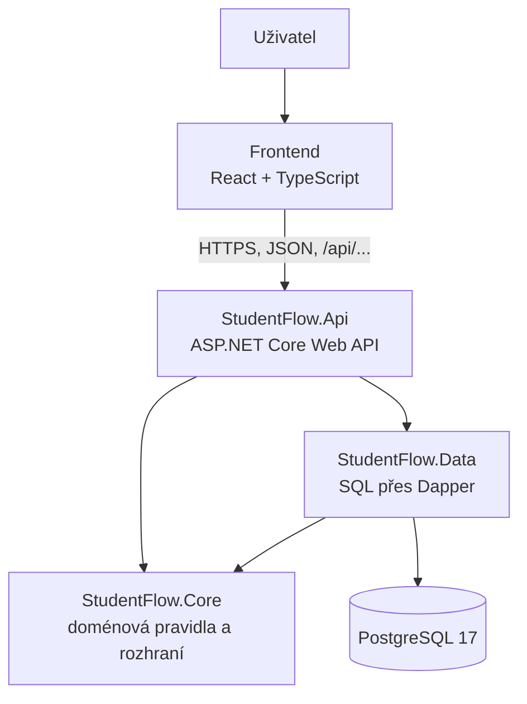

# Návrh architektury systému StudentFlow

## 1. Přehled

StudentFlow je webová aplikace typu klient–server. Frontend v prohlížeči komunikuje s backendem přes REST API (JSON přes HTTPS). Backend je rozdělený podle odpovědnosti na projekty `StudentFlow.Api`, `StudentFlow.Core` a `StudentFlow.Data` a data ukládá do PostgreSQL.

## 2. Komponenty

| Část | Odpovědnost |
| --- | --- |
| `studentflow.client` | Uživatelské rozhraní: registrace a přihlášení, dashboard, nástěnka, založení a nastavení projektu. API volá relativními adresami `/api/...`. |
| `StudentFlow.Api` | Controllery REST API, validace vstupů, autentizace session cookie s ochranou CSRF, kontrola oprávnění a registrace implementací přes dependency injection. Chyby vrací v jednotném tvaru (problem details s kódem chyby). |
| `StudentFlow.Core` | Doménová pravidla (formát e-mailu, jména a hesla, oprávnění k nástěnce, přesuny úkolů, správa členů) a rozhraní pro přístup k datům. Nezávisí na webové vrstvě ani na databázi. |
| `StudentFlow.Data` | Implementace rozhraní z Core: parametrizované SQL dotazy nad PostgreSQL přes Dapper a Npgsql. Neurčuje doménová pravidla. |
| Databáze | PostgreSQL 17. Schéma vzniká SQL migracemi v `database/migrations/`. |

Oprávnění vychází z typu účtu (člen, vyučující) a z role v konkrétním projektu (vedoucí, člen). Vyučující má nástěnky jen pro čtení, nastavení projektu spravuje pouze vedoucí týmu.

## 3. Použité technologie

| Část | Technologie |
| --- | --- |
| Frontend | React, TypeScript, Vite |
| Backend | C#, ASP.NET Core Web API (.NET 10) |
| Přístup k datům | Dapper, Npgsql |
| Databáze | PostgreSQL 17, schéma v SQL migracích |
| Testy | xUnit, Vitest, Playwright |
| Vývojové prostředí | Docker Compose pro PostgreSQL |

Důvody volby jednotlivých technologií uvádí [technologický návrh](TECHNOLOGICAL_DESIGN.md).

## 4. Průběh požadavku

1. Frontend odešle požadavek na `/api/...`. Ve vývoji ho Vite proxy předá API, takže prohlížeč pracuje s jedním originem a zabezpečenými cookies.
2. API ověří session, u zápisů také CSRF token, a zvaliduje vstup.
3. Controller použije pravidla z Core a data získá přes rozhraní, které implementuje Data.
4. Data provede SQL dotaz nad PostgreSQL a vrátí výsledek.
5. API vrátí odpověď ve formátu JSON a frontend podle ní aktualizuje rozhraní.

## 5. Závislosti mezi projekty

- `StudentFlow.Api` → `StudentFlow.Core`, `StudentFlow.Data`
- `StudentFlow.Data` → `StudentFlow.Core`
- `StudentFlow.Core` nezávisí na žádném dalším projektu.

Implementace z Data registruje Api při startu aplikace. Core tak není vázaný na konkrétní databázovou technologii.

## 6. Testy

Testy jsou oddělené od produkčního kódu. Backendové projekty jsou ve složce `tests/`, frontendové testy v projektu klienta.

| Sada | Co ověřuje |
| --- | --- |
| `StudentFlow.Core.Tests` | Doménová pravidla bez infrastruktury. |
| `StudentFlow.Api.Tests` | Controllery nad repozitářem v paměti. |
| `StudentFlow.Data.Tests` | Kontroly vstupů datové vrstvy bez databáze. |
| `StudentFlow.Data.IntegrationTests` | SQL dotazy, omezení a migrace nad skutečnou PostgreSQL 17. |
| `StudentFlow.Api.IntegrationTests` | Celé HTTP API včetně autentizace nad skutečnou PostgreSQL 17. |
| Vitest | Frontendová logika, hooky a komponenty. |
| Playwright | Uživatelské průchody v prohlížeči proti běžícímu API. |

Integrační testy si přes sdílený projekt `StudentFlow.Testing` zakládají izolované testovací databáze. Spuštění popisuje [testovací dokumentace](../TESTING.md).

## 7. Zdůvodnění hlavních rozhodnutí

- **Rozdělení backendu na Api, Core a Data.** Pravidla, která musí platit v API i při zápisu do databáze (e-mail, jméno, heslo, oprávnění), jsou na jednom místě v Core. API pracuje s rozhraními, takže controllery i pravidla se testují nad repozitáři v paměti bez databáze.
- **REST API na stejném originu jako frontend.** Frontend volá relativní adresy `/api/...`, ve vývoji je předává Vite proxy. Prohlížeč tak nepotřebuje CORS a může používat zabezpečené cookies s prefixem `__Host-`.
- **Serverová session v cookie místo tokenu v prohlížeči.** Cookie je `HttpOnly`, takže k ní JavaScript nemá přístup, a odhlášení session zneplatní přímo na serveru. Zápisové požadavky chrání CSRF token.
- **PostgreSQL s Dapperem a ručně psaným SQL.** Uživatelé, projekty, členství a úkoly jsou provázané vazbami, které relační databáze hlídá cizími klíči a omezeními. Dapper ponechává dotazy pod přímou kontrolou vývojářů.
- **Schéma v SQL migracích.** Migrace jsou obyčejné SQL soubory, které provádí PostgreSQL v Dockeru i testovací sady. Nepotřebují další nástroj a dají se zkontrolovat v code review.
