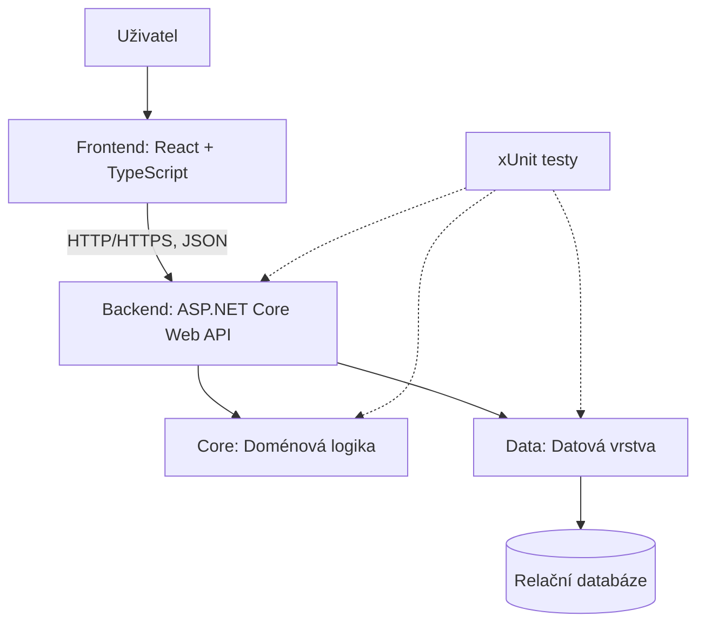

# Návrh architektury systému StudentFlow

## 1. Účel dokumentu

Tento dokument popisuje základní architekturu systému StudentFlow, jeho hlavní komponenty, jejich vzájemnou komunikaci a rozdělení odpovědností. Cílem je vytvořit přehledný a rozšiřitelný základ pro implementaci systému určeného ke správě studentských týmových projektů.

## 2. Přehled architektury

StudentFlow bude implementován jako webová aplikace využívající architekturu klient–server. Uživatelské rozhraní bude odděleno od backendové logiky a přístupu k datům. Komunikace mezi frontendem a backendem bude probíhat prostřednictvím REST API.

Architektura se skládá z následujících hlavních částí:

- **Frontend** – uživatelské rozhraní aplikace.
- **Backend API** – zpracování HTTP požadavků a poskytování aplikačních funkcí.
- **Core** – doménové entity, rozhraní a obchodní logika.
- **Data** – přístup k databázi a implementace datových operací.
- **Databáze** – trvalé ukládání aplikačních dat.
- **Testovací vrstva** – automatické ověřování správnosti jednotlivých částí systému.

## 3. Architektonický diagram

Diagram znázorňuje logické členění systému. Testovací projekty nejsou součástí běžného provozního toku aplikace.

## 4. Popis jednotlivých komponent

### 4.1 Frontend

Frontend zajišťuje komunikaci s uživatelem a prezentaci dat. Umožní uživatelům pracovat s projekty, týmy, úkoly a dalšími funkcemi systému.

Použité technologie:

- React
- TypeScript
- Vite
- HTML a CSS

Frontend bude komunikovat s backendem prostřednictvím HTTP požadavků na REST API. Data budou přenášena ve formátu JSON.

### 4.2 Backend API

Backend představuje vstupní bod pro požadavky frontendu. Zajišťuje zpracování HTTP požadavků, validaci vstupů, volání aplikační logiky a vracení odpovědí klientovi.

Použitá technologie:

- ASP.NET Core Web API

API bude rozděleno do endpointů a controllerů podle jednotlivých oblastí systému. Součástí backendu bude také konfigurace aplikace, zpracování chyb a případně autentizace a autorizace.

### 4.3 Core

Core představuje doménovou část aplikace. Obsahuje hlavní entity systému, pravidla a rozhraní potřebná pro realizaci aplikačních funkcí.

Příklady doménových oblastí:

- uživatelé a jejich role,
- týmy a členství,
- projekty,
- úkoly a jejich stavy,
- komentáře a další související data.

Core nebude přímo záviset na databázové implementaci ani na webové vrstvě. Tím bude možné testovat obchodní logiku nezávisle na infrastruktuře.

### 4.4 Data

Datová vrstva zajišťuje ukládání, načítání, změny a mazání dat. Bude implementovat přístup k databázi a případná rozhraní definovaná v Core.

Pro práci s relační databází lze využít Entity Framework Core. Konkrétní databázový systém bude určen technologickým návrhem.

### 4.5 Databáze

Databáze bude sloužit k trvalému ukládání údajů o uživatelích, týmech, projektech, úkolech a dalších objektech systému.

Datový model bude navržen s ohledem na vazby mezi jednotlivými entitami, integritu dat a budoucí rozšiřitelnost aplikace.

### 4.6 Testovací vrstva

Automatizované testy budou odděleny od produkčního kódu ve složce `tests/`.

Budou využívat framework xUnit a budou rozděleny podle testované komponenty:

- `StudentFlow.Api.Tests` – testování API a jeho chování.
- `StudentFlow.Core.Tests` – testování obchodní a doménové logiky.
- `StudentFlow.Data.Tests` – testování datové vrstvy.

## 5. Komunikace mezi komponentami

Komunikace bude probíhat následujícím způsobem:

1. Uživatel provede akci ve frontendové aplikaci.
2. Frontend odešle HTTP požadavek na odpovídající endpoint backendu.
3. Backend zpracuje požadavek a ověří vstupní data.
4. Potřebnou obchodní logiku zpracuje prostřednictvím doménové nebo aplikační vrstvy.
5. Při práci s daty backend využije datovou vrstvu, která komunikuje s databází.
6. Backend vrátí HTTP odpověď, zpravidla ve formátu JSON.
7. Frontend zpracuje odpověď a aktualizuje uživatelské rozhraní.

## 6. Závislosti mezi projekty

Závislosti mezi backendovými projekty budou nastaveny tak, aby doménová logika nebyla přímo závislá na technických detailech.

- `StudentFlow.Api` bude využívat `StudentFlow.Core` a při konfiguraci aplikace také implementace z `StudentFlow.Data`.
- `StudentFlow.Data` bude využívat `StudentFlow.Core` pro doménové typy a rozhraní.
- `StudentFlow.Core` nebude záviset na `StudentFlow.Api` ani `StudentFlow.Data`.
- Testovací projekty budou odkazovat na odpovídající testované projekty.

## 7. Zdůvodnění architektonických rozhodnutí

Oddělení frontendu a backendu umožní samostatný vývoj uživatelského rozhraní a serverové logiky. REST API vytvoří jasně definované rozhraní mezi oběma částmi.

Rozdělení backendu na API, Core a Data usnadní orientaci v kódu, údržbu a testování. Oddělení doménové logiky od databázových operací zároveň umožní v budoucnu změnit některé technické implementace bez nutnosti zásadně upravovat celý systém.

Automatizované testy pomohou ověřovat správnost implementace při dalším vývoji a při změnách stávajících funkcí.

## 8. Shrnutí

Navržená architektura poskytuje modulární základ pro vývoj systému StudentFlow. Jednotlivé části mají jasně vymezené odpovědnosti a komunikují prostřednictvím definovaných rozhraní. Návrh odpovídá současné struktuře repozitáře a umožňuje postupné doplňování funkcionality podle požadavků projektu.
