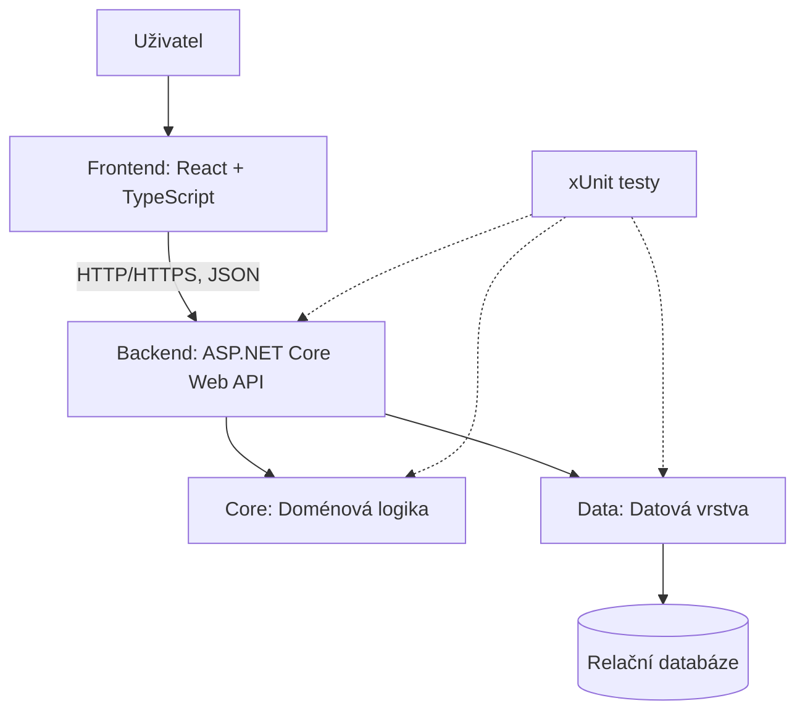

# Návrh architektury systému StudentFlow

## 1. Účel dokumentu

Tento dokument popisuje základní architekturu systému StudentFlow, jeho hlavní komponenty, jejich vzájemnou komunikaci a rozdělení odpovědností. Cílem je vytvořit přehledný a rozšiřitelný základ pro implementaci systému určeného ke správě studentských týmových projektů.

## 2. Přehled architektury

StudentFlow bude implementován jako webová aplikace využívající architekturu klient–server. Uživatelské rozhraní bude odděleno od backendu a přístupu k datům. Komunikace mezi frontendem a backendem bude probíhat prostřednictvím REST API.

Architektura se skládá z následujících hlavních částí:

- **Frontend** – uživatelské rozhraní aplikace a prezentace dat.
- **Backend API** – zpracování HTTP požadavků, validace vstupních dat a zprostředkování aplikačních funkcí.
- **Core** – doménové entity, pravidla, doménová logika a potřebná rozhraní.
- **Data** – přístup k databázi a implementace datových operací.
- **Databáze** – trvalé ukládání aplikačních dat.
- **Testovací vrstva** – automatické ověřování správnosti jednotlivých částí systému.

Jednotlivé části budou odděleny podle odpovědnosti, aby se usnadnil vývoj, testování a budoucí rozšiřování aplikace.

## 3. Architektonický diagram

Diagram znázorňuje logické členění systému a vztahy mezi jeho hlavními komponentami. Frontend komunikuje s backendem prostřednictvím REST API. Backend využívá doménovou logiku v projektu `StudentFlow.Core` a datové operace zajišťované projektem `StudentFlow.Data`. Datová vrstva komunikuje s databází.

Testovací projekty jsou odděleny od produkčního kódu a slouží k ověřování jednotlivých částí systému. Nejsou součástí běžného provozního toku aplikace.

## 4. Popis jednotlivých komponent

### 4.1 Frontend

Frontend zajišťuje komunikaci s uživatelem, prezentaci dat a ovládání funkcí systému. Umožní uživatelům pracovat s projekty, týmy, úkoly a dalšími funkcemi aplikace.

Použité technologie:

- React
- TypeScript
- Vite
- HTML a CSS

Frontend bude komunikovat s backendem prostřednictvím HTTP požadavků na REST API. Data budou přenášena ve formátu JSON.

### 4.2 Backend API

Backend představuje vstupní bod pro požadavky frontendu. Zajišťuje zpracování HTTP požadavků, validaci vstupních dat, volání příslušné doménové logiky a vracení odpovědí klientovi.

Použitá technologie:

- ASP.NET Core Web API

API bude rozděleno do endpointů a controllerů podle jednotlivých oblastí systému. Součástí backendu bude také konfigurace aplikace, zpracování chyb a zabezpečení prostřednictvím autentizace a autorizace podle uživatelských rolí.

Při konfiguraci aplikace budou zaregistrovány potřebné implementace rozhraní z datové vrstvy, aby je bylo možné využívat prostřednictvím mechanismu dependency injection.

### 4.3 Core

Core představuje doménovou část aplikace. Obsahuje hlavní entity systému, pravidla a rozhraní potřebná pro realizaci aplikačních funkcí.

Příklady doménových oblastí:

- uživatelé a jejich role,
- týmy a členství,
- projekty,
- úkoly a jejich stavy,
- komentáře a další související data.

V případě potřeby bude Core definovat také rozhraní pro přístup k datům, která budou implementována v projektu `StudentFlow.Data`.

Core nebude přímo záviset na databázové implementaci ani na webové vrstvě. Díky tomu bude možné testovat doménovou logiku nezávisle na databázové a webové infrastruktuře.

### 4.4 Data

Datová vrstva zajišťuje ukládání, načítání, změny a mazání dat. Bude obsahovat implementaci datových operací a případných rozhraní definovaných v projektu `StudentFlow.Core`.

Pro práci s relační databází lze využít Entity Framework Core. Konkrétní databázový systém a způsob přístupu k datům budou upřesněny v technologickém návrhu.

Datová vrstva nebude určovat doménová pravidla aplikace. Její hlavní odpovědností bude zajištění komunikace s databází a poskytování dat prostřednictvím definovaných rozhraní.

### 4.5 Databáze

Databáze bude sloužit k trvalému ukládání údajů o uživatelích, týmech, projektech, úkolech a dalších objektech systému.

Datový model bude navržen s ohledem na vazby mezi jednotlivými entitami, integritu dat a budoucí rozšiřitelnost aplikace.

Konkrétní databázový systém zatím není v tomto dokumentu pevně stanoven.

### 4.6 Testovací vrstva

Automatizované testy budou odděleny od produkčního kódu ve složce `tests/`.

Budou využívat framework xUnit a budou rozděleny podle testované komponenty:

- `StudentFlow.Api.Tests` – testování API, jeho endpointů a chování při zpracování požadavků.
- `StudentFlow.Core.Tests` – testování doménové logiky a pravidel implementovaných v projektu `StudentFlow.Core`.
- `StudentFlow.Data.Tests` – testování datové vrstvy a operací pro práci s databází.

Testy pomohou odhalovat chyby při vývoji a ověřovat, že změny v jedné části systému nenaruší již implementovanou funkcionalitu.

## 5. Komunikace mezi komponentami

Komunikace mezi jednotlivými částmi systému bude probíhat následujícím způsobem:

1. Uživatel provede akci ve frontendové aplikaci.
2. Frontend odešle HTTP požadavek na odpovídající endpoint backendu.
3. Backend zpracuje požadavek a ověří vstupní data.
4. Backend využije příslušnou doménovou logiku a pravidla definovaná v projektu `StudentFlow.Core`.
5. Pokud je potřeba pracovat s databázovými daty, využije se odpovídající rozhraní, jehož implementaci zajišťuje projekt `StudentFlow.Data`.
6. Datová vrstva provede potřebnou operaci s databází a vrátí výsledek.
7. Backend připraví HTTP odpověď, zpravidla ve formátu JSON.
8. Frontend zpracuje odpověď a aktualizuje uživatelské rozhraní.

Přístup k funkcím systému bude zabezpečen autentizací a autorizací podle požadavků na přihlašování a uživatelské role.

## 6. Závislosti mezi projekty

Závislosti mezi backendovými projekty budou nastaveny tak, aby doménová logika nebyla přímo závislá na technických detailech.

- `StudentFlow.Api` bude využívat `StudentFlow.Core` a při konfiguraci aplikace také implementace z `StudentFlow.Data`.
- `StudentFlow.Data` bude využívat `StudentFlow.Core` pro doménové typy a případná rozhraní pro přístup k datům.
- `StudentFlow.Core` nebude záviset na `StudentFlow.Api` ani `StudentFlow.Data`.
- Testovací projekty budou odkazovat na odpovídající testované projekty.

Implementace rozhraní z projektu `StudentFlow.Data` budou při startu aplikace zaregistrovány v projektu `StudentFlow.Api` prostřednictvím dependency injection. Tím bude možné využívat datové operace bez přímé závislosti doménové logiky na konkrétní databázové technologii.

## 7. Zdůvodnění architektonických rozhodnutí

Oddělení frontendu a backendu umožní samostatný vývoj uživatelského rozhraní a serverové logiky. REST API vytvoří jasně definované rozhraní mezi oběma částmi aplikace.

Rozdělení backendu na projekty `Api`, `Core` a `Data` usnadní orientaci v kódu, údržbu a testování. Každá část bude mít jasně vymezenou odpovědnost.

Oddělení doménové logiky od databázových operací umožní měnit technické implementace bez nutnosti zásadně upravovat celou aplikaci. Definování rozhraní v projektu `Core` navíc umožní testovat doménovou logiku nezávisle na konkrétní databázi.

Automatizované testy pomohou ověřovat správnost implementace při dalším vývoji a při změnách stávajících funkcí. Rozdělení testů podle jednotlivých projektů usnadní identifikaci případných problémů.

## 8. Shrnutí

Návrh vychází ze současné struktury repozitáře a vymezuje plánované odpovědnosti jednotlivých projektů. Architektura odděluje uživatelské rozhraní, backend, doménovou logiku, datovou vrstvu a automatizované testy.

Jednotlivé části budou propojeny prostřednictvím definovaných rozhraní a standardní komunikace přes REST API. Návrh umožňuje postupné doplňování funkcionality podle požadavků projektu a vytváří základ pro další vývoj a testování systému StudentFlow.
