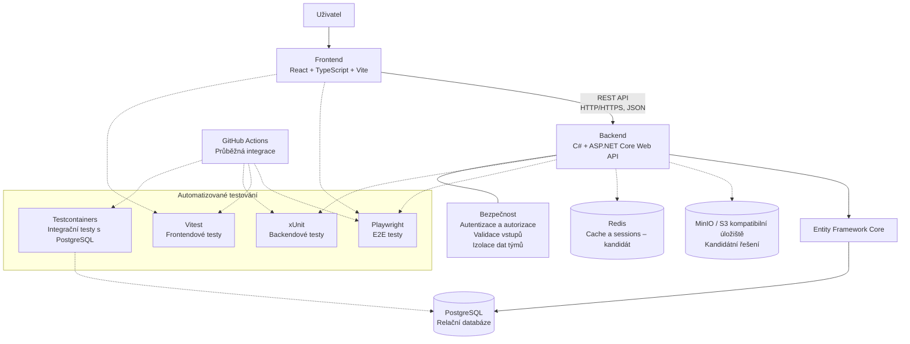

# 6.2 Technologický návrh systému StudentFlow

## 1. Účel dokumentu

Tento dokument popisuje technologické řešení systému StudentFlow. Uvádí zvolené technologie, jejich využití v jednotlivých částech aplikace a zdůvodnění jejich výběru.

Cílem je vytvořit webovou aplikaci pro správu studentských týmových projektů, která bude přehledná, udržovatelná, bezpečná a rozšiřitelná. Technologický návrh vychází z aktuální struktury repozitáře, požadavků systému a potřeb vývojového týmu.

Dokument rozlišuje mezi technologiemi, které jsou pro projekt zvolené, a kandidátními řešeními, o jejichž zavedení musí tým ještě rozhodnout.

## 2. Přehled technologií

| Oblast | Technologie | Stav |
| :--- | :--- | :--- |
| Frontend | React | Zvoleno |
| Programovací jazyk frontendu | TypeScript | Zvoleno |
| Vývoj a sestavení frontendu | Vite | Zvoleno |
| Backend | C# a ASP.NET Core Web API | Zvoleno |
| Komunikace | REST API, HTTP/HTTPS, JSON | Zvoleno |
| Databáze | PostgreSQL | Zvoleno |
| Přístup k databázi | Entity Framework Core | Navrženo |
| Úložiště souborů | MinIO nebo jiné S3 kompatibilní úložiště | Kandidátní řešení |
| Cache a sessions | Redis | Kandidát |
| E2E testování | Playwright | Zvoleno pro automatizované testování uživatelských scénářů |
| Testování frontendu | Vitest | Navrženo |
| Testování backendu | xUnit | Zvoleno |
| Databázové integrační testy | Testcontainers | Navrženo |
| Správa zdrojového kódu | Git a GitHub | Používáno |
| Průběžná integrace | GitHub Actions | Použije se pro automatizaci sestavení a testů |
| Kontejnerové prostředí | Docker a případně Docker Compose | Možnost pro vývoj a testování |

## 3. Diagram technologického řešení

Diagram znázorňuje hlavní technologické komponenty systému StudentFlow a jejich vzájemné vztahy. Plné šipky představují hlavní provozní tok aplikace, zatímco přerušované šipky znázorňují vazby související s testováním nebo kandidátními komponentami.

PostgreSQL a backend ASP.NET Core jsou součástí zvoleného řešení. MinIO nebo jiné S3 kompatibilní úložiště a Redis zůstávají kandidátními možnostmi, jejichž zavedení bude záviset na potřebách aplikace.

## 4. Frontend

### 4.1 React

React bude použit pro tvorbu uživatelského rozhraní aplikace. Umožňuje rozdělit rozhraní do samostatných a opakovaně použitelných komponent, což usnadňuje vývoj, údržbu a rozšiřování aplikace.

Ve StudentFlow bude zajišťovat zobrazování projektů, týmů, úkolů a dalších informací. Umožní také vytvářet formuláře a interaktivní prvky, prostřednictvím kterých budou uživatelé se systémem pracovat.

React byl zvolen také proto, že frontendová aplikace je již v této technologii vytvořena. Zachování stávajícího řešení umožňuje navázat na dosavadní práci a soustředit se na implementaci požadovaných funkcí.

### 4.2 TypeScript

TypeScript bude použit jako hlavní programovací jazyk frontendové aplikace. Rozšiřuje JavaScript o statickou typovou kontrolu, která pomáhá odhalovat některé chyby již během vývoje.

V projektu bude využit pro implementaci komponent, definování datových struktur a zpracování odpovědí REST API. Typování pomůže sjednotit očekávanou podobu dat a usnadní spolupráci více členů týmu.

### 4.3 Vite

Vite bude sloužit jako nástroj pro vývoj a sestavení frontendové aplikace. Poskytuje vývojový server a připravuje aplikaci pro nasazení.

Byl zvolen jako součást současného frontendového projektu. Umožňuje rychle ověřovat změny během vývoje a odděluje proces sestavení aplikace od její vlastní implementace.

### 4.4 HTML a CSS

HTML a CSS budou využity pro strukturu a vzhled uživatelského rozhraní. HTML zajistí strukturu jednotlivých částí aplikace a CSS jejich vizuální podobu, rozvržení a přizpůsobení různým velikostem obrazovek.

## 5. Backend

### 5.1 C# a ASP.NET Core Web API

Backend bude implementován v jazyce C# s využitím ASP.NET Core Web API. Tato technologie umožňuje vytvářet webová API, zpracovávat HTTP požadavky a poskytovat serverové funkce dalším částem aplikace.

Backend bude odpovědný za zpracování operací s projekty, týmy, úkoly a dalšími objekty systému. Bude také provádět validaci vstupních dat, kontrolu oprávnění uživatelů a přípravu odpovědí pro frontend.

ASP.NET Core bylo zvoleno také proto, že repozitář již obsahuje základ backendu a samostatné projekty pro API, doménovou logiku a datovou vrstvu. Pokračování v této technologii umožní využít existující strukturu a omezí náklady na případný přechod na jiný framework.

### 5.2 Rozdělení backendu

Backend bude rozdělen do tří projektů podle jejich odpovědností:

- **StudentFlow.Api** – zpracování HTTP požadavků, endpointy, controllery a konfigurace aplikace.
- **StudentFlow.Core** – doménové entity, pravidla a potřebná rozhraní.
- **StudentFlow.Data** – přístup k databázi a implementace datových operací.

Toto rozdělení podporuje oddělení webové komunikace, doménové logiky a přístupu k datům. Usnadní také samostatné testování jednotlivých částí systému.

Projekt `StudentFlow.Core` nebude přímo záviset na projektech `StudentFlow.Api` ani `StudentFlow.Data`. Datová vrstva bude využívat potřebné typy a rozhraní z projektu `Core`. Implementace potřebných rozhraní budou při konfiguraci aplikace zaregistrovány prostřednictvím dependency injection.

## 6. Komunikace mezi komponentami

### 6.1 REST API

REST API bude zajišťovat komunikaci mezi frontendem a backendem. Frontend bude odesílat požadavky na jednotlivé endpointy backendu, který je zpracuje a vrátí odpovídající odpověď.

Jednotlivé operace budou využívat vhodné HTTP metody:

- `GET` – načtení dat.
- `POST` – vytvoření nového záznamu.
- `PUT` nebo `PATCH` – aktualizace existujících dat.
- `DELETE` – odstranění záznamu.

REST API bylo zvoleno proto, že vytváří jasně definované rozhraní mezi frontendem a backendem. Obě části lze vyvíjet samostatně, pokud dodržují dohodnutou strukturu požadavků a odpovědí.

### 6.2 HTTP/HTTPS a JSON

Data budou mezi frontendem a backendem přenášena ve formátu JSON. Ten je vhodný pro výměnu strukturovaných dat a lze jej snadno zpracovat v TypeScriptu i v .NET.

Při nasazení aplikace bude komunikace chráněna pomocí HTTPS. Šifrované spojení pomůže chránit přenášená data před odposlechem a neoprávněnými zásahy během přenosu.

## 7. Databáze a přístup k datům

### 7.1 PostgreSQL

Pro ukládání strukturovaných dat systému StudentFlow byla zvolena relační databáze PostgreSQL.

Aplikace bude pracovat s propojenými údaji o uživatelích, rolích, týmech, projektech, úkolech a dalších objektech. Relační databáze umožňuje tyto vztahy zachytit pomocí tabulek, primárních a cizích klíčů a integritních omezení.

PostgreSQL bylo zvoleno z následujících důvodů:

- Podporuje relační datový model vhodný pro vzájemně propojené informace.
- Podporuje transakce, které pomáhají zachovávat konzistenci dat při změnách.
- Je dostupné jako open-source řešení bez licenčních poplatků za samotný databázový systém.
- Lze jej provozovat v běžném vývojovém i nasazeném prostředí.
- Je možné jej propojit s backendem v .NET prostřednictvím odpovídajícího databázového poskytovatele.

Datový model bude navržen s ohledem na vazby mezi entitami a na oprávnění uživatelů přistupovat pouze k datům, ke kterým mají oprávnění.

### 7.2 Entity Framework Core

Pro přístup k PostgreSQL z backendu ASP.NET Core se navrhuje využít Entity Framework Core. Jedná se o objektově-relační mapovací nástroj (ORM), který umožňuje pracovat s databázovými záznamy prostřednictvím tříd a objektů v C#.

Entity Framework Core bude možné využít v projektu `StudentFlow.Data` pro načítání, ukládání, aktualizaci a mazání dat. Podporuje také správu databázového schématu prostřednictvím migrací.

Jeho použití může snížit množství opakujícího se SQL kódu a pomoci udržet přístup k datům oddělený od doménové logiky. Pro PostgreSQL bude potřeba použít odpovídající databázový provider.

## 8. Úložiště souborů

### 8.1 MinIO nebo S3 kompatibilní úložiště

Pro ukládání souborů nahrávaných uživateli se zvažuje MinIO nebo jiné úložiště kompatibilní s rozhraním Amazon S3.

Objektové úložiště je vhodné pro přílohy projektů, dokumenty a další uživatelský obsah. Umožní oddělit obsah souborů od strukturovaných dat uložených v PostgreSQL.

Databáze bude uchovávat především metadata souborů, například název, typ, identifikátor úložiště a vazbu na příslušný projekt nebo tým. Samotný obsah souboru bude uložen v objektovém úložišti.

Kandidátní řešení bude vyhodnoceno podle snadnosti nasazení, způsobu zabezpečení přístupu, dostupných funkcí a rozsahu projektu.

Přístup k souborům bude kontrolován backendem. Uživatel nesmí získat přístup k souborům jiného týmu pouze na základě znalosti jejich identifikátoru.

## 9. Cache a sessions

### 9.1 Redis

Redis je zvažován jako možné řešení pro ukládání dočasných dat, cachování často používaných informací a případnou správu sdílených sessions.

Cache by mohla snížit počet opakovaných databázových dotazů a urychlit načítání často používaných údajů. Sdílené sessions mohou být užitečné, pokud zvolený způsob autentizace bude vyžadovat uchovávání session stavu mimo proces backendu.

Redis však není nezbytnou součástí první verze aplikace. Jeho zavedení bude záviset na skutečných požadavcích na výkon, zvoleném způsobu autentizace a složitosti řešení. Pokud nebude přinášet dostatečný přínos, nebude do systému přidáván pouze kvůli rozšiřování technologického stacku.

## 10. Testování

Testování bude rozděleno podle účelu na jednotkové, integrační a end-to-end testy.

### 10.1 Playwright – end-to-end testování

Playwright bude využit pro automatizované end-to-end (E2E) testování webové aplikace prostřednictvím prohlížeče.

Umožní ověřovat celé uživatelské scénáře, například přihlášení, vytvoření projektu, přidání člena do týmu nebo práci s úkoly. Tím ověří spolupráci frontendu a backendu z pohledu uživatele.

Playwright doplní jednotkové a integrační testy o testování skutečného průchodu aplikací. Díky tomu bude možné odhalovat problémy, které samotné testování jednotlivých komponent nemusí zachytit.

### 10.2 Vitest – frontendové testy

Vitest bude využit pro jednotkové a případně integrační testování frontendového kódu v TypeScriptu.

Umožní testovat jednotlivé funkce a další části frontendové logiky bez nutnosti provádět celý uživatelský scénář v prohlížeči. Společně s Playwrightem tak pokryje různé úrovně testování frontendové aplikace.

### 10.3 xUnit – backendové testy

Pro automatizované testování backendových projektů bude využit framework xUnit, který je určen pro aplikace v prostředí .NET.

Testovací projekty budou rozděleny podle testované komponenty:

- `StudentFlow.Api.Tests` – testování API, endpointů a jejich chování.
- `StudentFlow.Core.Tests` – testování doménové logiky a pravidel implementovaných v projektu `StudentFlow.Core`.
- `StudentFlow.Data.Tests` – testování datové vrstvy a jejích operací.

Rozdělení umožní lépe určit, ve které části aplikace se případný problém nachází.

### 10.4 Testcontainers – databázové integrační testy

Testcontainers umožňuje spouštět závislé služby v izolovaných kontejnerech pro účely testování. Ve StudentFlow se navrhuje využít jej pro integrační testy, které potřebují skutečnou instanci PostgreSQL.

Umožní testovat reálné databázové operace, ukládání a načítání dat a chování datové vrstvy bez nutnosti používat sdílenou vývojovou databázi.

Testcontainers lze propojit s automatizovaným testováním v CI, pokud bude pro běh testů dostupné odpovídající kontejnerové prostředí.

## 11. Infrastruktura a týmová spolupráce

### 11.1 Git a GitHub

Git bude využit pro správu verzí zdrojového kódu. Umožňuje sledovat historii změn, vytvářet větve, slučovat práci členů týmu a vracet se k předchozím verzím.

GitHub bude sloužit jako společné úložiště zdrojového kódu a dokumentace. Podpoří týmovou spolupráci, kontrolu změn a propojení vývoje s automatizovaným testováním.

### 11.2 GitHub Actions

GitHub Actions bude využit pro průběžnou integraci (CI). Umožní automaticky spouštět definované kontroly při změnách v repozitáři.

Workflow v souboru `.github/workflows/ci.yml` bude postupně nastaven tak, aby podle aktuální konfigurace ověřoval sestavení aplikace a spouštěl odpovídající testy.

Do CI se navrhuje zahrnout zejména:

- sestavení backendu,
- sestavení frontendu,
- automatizované jednotkové a integrační testy,
- E2E testy pomocí Playwrightu,
- databázové testy vyžadující PostgreSQL prostřednictvím Testcontainers.

Automatizace pomůže odhalovat chyby průběžně a omezí riziko, že se do hlavní větve dostanou nefunkční změny.

### 11.3 Docker a Docker Compose

Docker lze využít pro spuštění podpůrných služeb ve vývojovém a testovacím prostředí, například PostgreSQL a případně objektového úložiště nebo Redis.

Docker Compose může sjednotit konfiguraci a spuštění těchto služeb napříč prostředími jednotlivých členů týmu.

Docker bude rovněž užitečný při databázových testech prostřednictvím Testcontainers. Rozsah jeho využití pro běžné spouštění celé aplikace může být upřesněn během implementace.

## 12. Bezpečnost

Bezpečnost je důležitou součástí technologického návrhu, protože systém bude zpracovávat uživatelské účty, týmová data, projekty a případné přílohy.

### 12.1 HTTPS

Při nasazení aplikace bude komunikace mezi klientem a serverem chráněna pomocí HTTPS. Šifrované spojení pomáhá chránit přenášená data před odposlechem a neoprávněnými zásahy během přenosu.

### 12.2 Autentizace a autorizace podle rolí

Systém bude ověřovat identitu uživatele a řídit přístup k funkcím podle jeho role. Oprávnění budou kontrolována na backendu, nikoli pouze skrytím prvků v uživatelském rozhraní.

Autentizace slouží k ověření identity uživatele, zatímco autorizace určuje, jaké operace může provádět.

### 12.3 Validace vstupních dat

Backend bude validovat vstupy od uživatelů před jejich dalším zpracováním a uložením do databáze. Validace ve frontendu pomůže zlepšit uživatelský komfort, ale nenahrazuje serverovou kontrolu.

U souborů bude potřeba ověřovat například povolené typy, velikost souboru a oprávnění uživatele k jeho nahrávání.

### 12.4 Izolace dat mezi týmy

Jedním z hlavních bezpečnostních požadavků je zabránit tomu, aby člen jednoho týmu získal neoprávněný přístup k datům jiného týmu.

Backend bude při práci s projekty, úkoly, soubory a dalšími týmovými objekty ověřovat, zda má přihlášený uživatel k danému objektu odpovídající oprávnění.

Kontrola musí proběhnout při každém relevantním požadavku. Nestačí spoléhat pouze na identifikátory posílané klientem ani na omezení viditelnosti dat ve frontendu.

## 13. Otevřená technologická rozhodnutí

Přestože hlavní technologie byly vybrány, několik oblastí vyžaduje ještě rozhodnutí týmu:

1. **Úložiště souborů:** vybrat mezi MinIO a jiným S3 kompatibilním řešením podle požadavků na nasazení a zabezpečení.
2. **Redis:** rozhodnout, zda je cache nebo sdílená session vrstva potřebná již v první verzi aplikace.
3. **Entity Framework Core:** potvrdit jeho použití a odpovídající PostgreSQL provider v datové vrstvě.
4. **Testcontainers a Docker Compose:** určit rozsah použití v lokálním prostředí a v CI.
5. **Konfigurace CI:** ověřit, které sestavovací a testovací kroky už workflow `ci.yml` obsahuje, a doplnit případné chybějící kontroly.

Tato rozhodnutí budou provedena podle skutečných požadavků projektu. Kandidátní technologie nebudou zaváděny bez jasného důvodu.

## 14. Zdůvodnění celkového technologického řešení

Zvolené technologie tvoří vzájemně kompatibilní celek. React, TypeScript a Vite pokrývají vývoj uživatelského rozhraní. C# a ASP.NET Core Web API zajišťují serverovou část a REST API vytváří jasné rozhraní mezi klientem a serverem.

PostgreSQL poskytuje relační úložiště pro propojené údaje o uživatelích, týmech, projektech a úkolech. Entity Framework Core může zjednodušit přístup k datům a zachovat oddělení databázových operací od doménové logiky.

Playwright, Vitest a xUnit umožní testovat uživatelské scénáře, frontendovou logiku a backendové komponenty. Testcontainers doplní testování o operace se skutečnou databází. GitHub Actions podpoří automatické ověřování změn během vývoje.

Návrh zahrnuje také bezpečnostní opatření, především autorizaci podle rolí, validaci vstupů a izolaci týmových dat. Úložiště souborů a Redis zůstávají volitelnými rozšířeními, která budou zavedena podle potřeb aplikace.

## 15. Shrnutí

Technologický návrh systému StudentFlow je založen na frontendu React, TypeScript a Vite, backendu C# a ASP.NET Core Web API a relační databázi PostgreSQL. Komunikace mezi frontendem a backendem bude probíhat prostřednictvím REST API s daty ve formátu JSON.

Pro přístup k databázi se navrhuje Entity Framework Core. Testování bude rozděleno mezi Playwright pro E2E scénáře, Vitest pro frontend, xUnit pro backend a Testcontainers pro databázové integrační testy.

GitHub Actions bude využit k průběžnému ověřování sestavení a testů. Návrh klade důraz na HTTPS, autorizaci podle rolí, validaci vstupů a ochranu dat mezi týmy.

MinIO nebo jiné S3 kompatibilní úložiště a Redis zůstávají kandidátními řešeními, jejichž zavedení závisí na potřebách systému. Dokument tak stanovuje základní technologický směr projektu a současně vymezuje oblasti, které je potřeba ještě potvrdit.

## 16. Použité zdroje

- React – oficiální dokumentace: https://react.dev/
- TypeScript – oficiální dokumentace: https://www.typescriptlang.org/docs/
- Vite – oficiální dokumentace: https://vite.dev/guide/
- ASP.NET Core Web API – oficiální dokumentace: https://learn.microsoft.com/en-us/aspnet/core/web-api/
- Entity Framework Core – oficiální dokumentace: https://learn.microsoft.com/en-us/ef/core/
- PostgreSQL – oficiální dokumentace: https://www.postgresql.org/docs/
- MinIO – oficiální dokumentace: https://min.io/docs/
- Redis – oficiální dokumentace: https://redis.io/docs/latest/
- Playwright – oficiální dokumentace: https://playwright.dev/docs/intro
- Vitest – oficiální dokumentace: https://vitest.dev/guide/
- xUnit – oficiální dokumentace: https://xunit.net/
- Testcontainers pro .NET – dokumentace: https://dotnet.testcontainers.org/
- GitHub Actions – oficiální dokumentace: https://docs.github.com/en/actions
- Docker Compose – oficiální dokumentace: https://docs.docker.com/compose/
