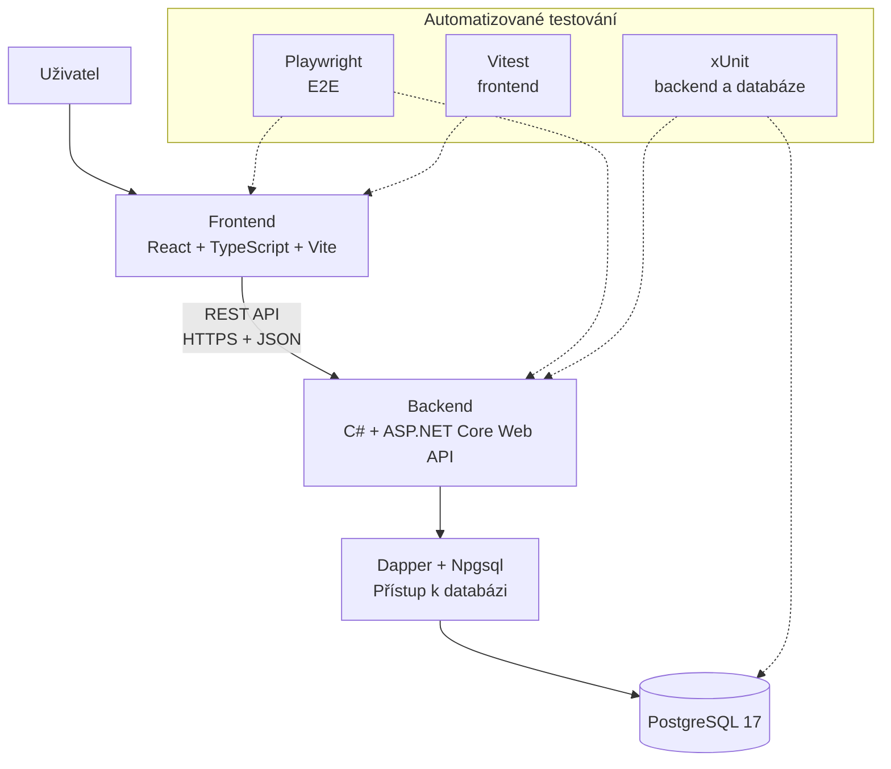

# 6.2 Technologický návrh systému StudentFlow

## 1. Přehled technologií

| Oblast | Technologie | Účel ve StudentFlow |
| :--- | :--- | :--- |
| Frontend | React | Uživatelské rozhraní složené z komponent. |
| Frontend | dnd-kit | Přetahování úkolů na Kanban nástěnce myší a dotykem. |
| Frontend | Sass (SCSS) | Styly jednotlivých komponent. |
| Frontend | TypeScript | Typová kontrola kódu a dat z API. |
| Frontend | Vite | Vývojový server s HTTPS a proxy na API, produkční sestavení. |
| Backend | C#, ASP.NET Core Web API (.NET 10) | REST API, autentizace a oprávnění. |
| Backend | REST API, HTTPS, JSON | Komunikace s frontendem. |
| Databáze | PostgreSQL 17 | Trvalé uložení dat. |
| Databáze | Dapper, Npgsql | SQL dotazy z backendu a mapování výsledků na objekty v C#. |
| Testování | xUnit | Jednotkové a integrační testy backendu. |
| Testování | Vitest, Testing Library | Jednotkové a komponentové testy frontendu. |
| Testování | Playwright | Uživatelské průchody v prohlížeči (E2E). |
| Infrastruktura | Docker Compose | Lokální PostgreSQL pro celý tým. |
| Infrastruktura | GitHub Actions | Sestavení, testy, lint a audit závislostí u pull requestů do `main`. |

Frontend vyžaduje Node.js 22, backend .NET 10 SDK.

## 2. Diagram technologického řešení

Plné šipky představují provozní tok aplikace, přerušované šipky automatizované testování.

## 3. Frontend

### 3.1 React

React řeší celé uživatelské rozhraní: přihlášení a registraci, dashboard, Kanban nástěnku a správu projektu. Rozhraní se skládá z opakovaně použitelných komponent (karta úkolu, sloupec, formuláře) a při změně stavu, například filtru nebo přesunu úkolu, se překreslí bez načtení stránky. React má rozsáhlý ekosystém knihoven, ze kterého projekt využívá dnd-kit a Testing Library. Visual Studio nabízí šablonu, která React frontend a ASP.NET Core backend spojuje v jedné solution.

### 3.2 dnd-kit

Knihovna dnd-kit pro React zajišťuje přetahování úkolů mezi sloupci nástěnky myší i dotykem. Na mobilu nástěnka místo přetahování nabízí výběr cílového sloupce.

### 3.3 Sass

Styly komponent jsou psané v SCSS (Sass). Každá komponenta má vlastní soubor stylů vedle svého kódu; oproti čistému CSS umožňuje SCSS vnořování pravidel.

### 3.4 TypeScript

TypeScript je jazyk celého frontendu. Statická typová kontrola odhalí chyby už při sestavení, například chybějící pole nebo špatný typ v datech z API. Odpovědi API frontend při načtení ověřuje a dál s nimi pracuje jako s typovanými objekty.

### 3.5 Vite

Vite slouží jako vývojový server a nástroj pro produkční sestavení. Při vývoji běží přes HTTPS a požadavky na `/api/...` předává backendu, takže prohlížeč pracuje s jedním originem a zabezpečenými cookies. Změny v kódu se v prohlížeči projeví okamžitě bez obnovení stránky.

## 4. Backend

### 4.1 C# a ASP.NET Core Web API

Backend je napsaný v C# nad ASP.NET Core Web API (.NET 10). Framework obsahuje vše, co StudentFlow potřebuje k zabezpečení, bez dalších knihoven:

- vlastní autentizační schéma pro serverovou session v cookie,
- ochranu proti CSRF (antiforgery),
- hashování hesel (`PasswordHasher`, PBKDF2),
- omezení počtu pokusů o registraci a přihlášení (rate limiting).

Silné typování C# zachycuje chyby už při překladu a dovoluje sdílet doménové typy mezi projekty `Api`, `Core` a `Data`. Rozdělení backendu na tyto projekty popisuje [návrh architektury](ARCHITECTURAL_DESIGN.md).

### 4.2 REST API a JSON

Frontend a backend komunikují přes REST API. API používá metody `GET` (načtení), `POST` (vytvoření, přihlášení), `PUT` (přesun úkolu) a `DELETE` (odebrání člena). Data se přenášejí ve formátu JSON, který se snadno zpracovává v TypeScriptu i v .NET. Komunikace probíhá přes HTTPS i při lokálním vývoji, aby fungovaly zabezpečené cookies.

## 5. Databáze a přístup k datům

### 5.1 PostgreSQL 17

Data StudentFlow (uživatelé, projekty, členství, sloupce a úkoly) jsou vzájemně provázaná. Relační databáze PostgreSQL je ukládá do tabulek a vazby hlídá cizími klíči, omezeními a transakcemi. PostgreSQL bylo zvoleno, protože:

- je open-source bez licenčních poplatků a běží ve vývoji, v CI i při nasazení,
- nabízí odložené kontroly omezení, díky kterým lze účet a jeho typ založit v jedné transakci,
- podporuje české řazení textu (ICU collation `cs-x-icu`), například pro seznam členů,
- má kvalitní ovladač pro .NET (Npgsql).

### 5.2 Dapper a Npgsql

Projekt `StudentFlow.Data` přistupuje k databázi přes Dapper, lehký mapovací nástroj (micro-ORM), nad ovladačem Npgsql. Dotazy jsou psané ručně v SQL a parametrizované. Vývojáři tak mají nad dotazy přímou kontrolu a mohou využít funkce PostgreSQL, které by plnohodnotné ORM skrývalo (zamykání řádků, české řazení). Dapper výsledky dotazů mapuje na objekty v C#.

### 5.3 SQL migrace

Schéma databáze vzniká obyčejnými SQL soubory v `database/migrations/`. Provádí je PostgreSQL v Dockeru při prvním startu i testovací sady, takže nepotřebují další nástroj a dají se zkontrolovat v code review.

## 6. Automatizované testování

### 6.1 xUnit

Backend testuje xUnit, standardní testovací framework pro .NET s podporou v Test Exploreru Visual Studia.

| Projekt | Co ověřuje |
| :--- | :--- |
| `StudentFlow.Core.Tests` | Doménová pravidla bez infrastruktury. |
| `StudentFlow.Api.Tests` | Controllery nad repozitářem v paměti. |
| `StudentFlow.Data.Tests` | Kontroly vstupů datové vrstvy bez databáze. |
| `StudentFlow.Data.IntegrationTests` | SQL dotazy, omezení a migrace nad PostgreSQL 17. |
| `StudentFlow.Api.IntegrationTests` | Celé HTTP API přes `WebApplicationFactory` nad PostgreSQL 17. |

Integrační testy běží proti skutečné PostgreSQL 17, kterou určuje proměnná `STUDENTFLOW_TEST_DATABASE`. Sdílený projekt `StudentFlow.Testing` pro každý test založí izolovanou databázi a po testu ji odstraní.

### 6.2 Vitest a Testing Library

Vitest spouští jednotkové a komponentové testy frontendu: validace formulářů, API klienty, hooky a komponenty. Je postavený na Vite, takže testy překládají kód stejně jako vývojový server. Testing Library vykresluje komponenty v prostředí jsdom a ověřuje je tak, jak je vidí uživatel. Testy jsou rychlé a nepotřebují prohlížeč ani backend.

### 6.3 Playwright

Playwright ověřuje celé uživatelské průchody, například registraci, přihlášení, práci s nástěnkou a správu členů, proti běžícímu frontendu, API a databázi. Testy běží v prohlížečích Chromium, Firefox a WebKit a emulují mobilní a tabletové rozměry, což pokrývá požadavky na kompatibilitu a responzivitu (NP07, NP09).

## 7. Infrastruktura a vývojové prostředí

### 7.1 Docker Compose

`compose.yaml` spouští PostgreSQL 17 se stejnou konfigurací pro všechny členy týmu, bez lokální instalace databáze. Při prvním startu nového datového svazku provede migrace z `database/migrations/`.

### 7.2 GitHub Actions

Workflow `.github/workflows/ci.yml` při každém pull requestu a pushi do `main` sestaví backend a spustí:

- jednotkové testy backendu,
- databázové a API integrační testy proti službě `postgres:17`,
- lint (ESLint), audit závislostí, testy a sestavení frontendu,
- E2E testy v oficiálním Docker image Playwrightu.
