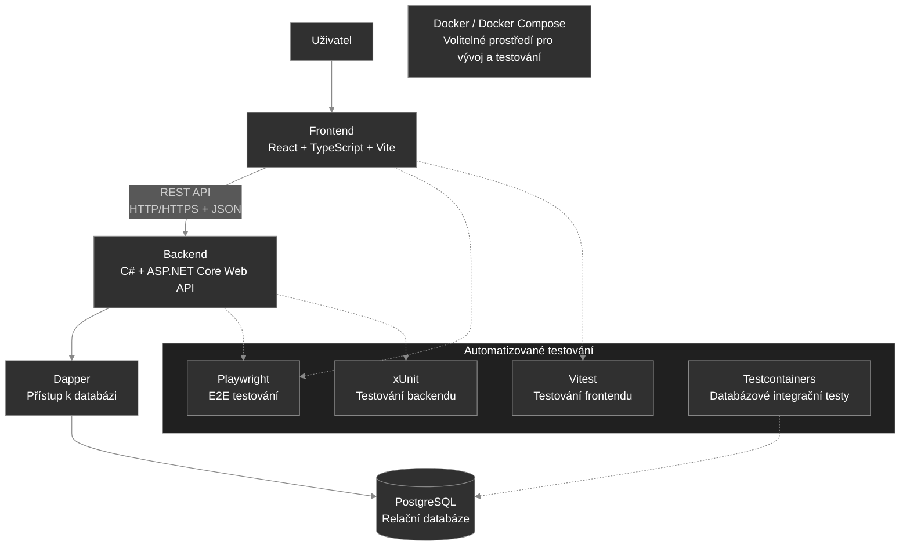

# 6.2 Technologický návrh systému StudentFlow

## 1. Účel dokumentu

Tento dokument popisuje technologické řešení systému StudentFlow. Uvádí zvolené technologie, jejich využití v jednotlivých částech aplikace a zdůvodnění jejich výběru.

Cílem je vytvořit webovou aplikaci pro správu studentských týmových projektů, která bude přehledná, udržovatelná, bezpečná a rozšiřitelná. Technologický návrh vychází z aktuální struktury repozitáře, požadavků systému a potřeb vývojového týmu.

Dokument rozlišuje mezi zvolenými technologiemi a technologiemi, jejichž využití je zatím navržené nebo volitelné.

## 2. Přehled technologií

| Oblast | Technologie | Stav |
| :--- | :--- | :--- |
| Frontend | React | Zvoleno |
| Programovací jazyk frontendu | TypeScript | Zvoleno |
| Vývoj a sestavení frontendu | Vite | Zvoleno |
| Backend | C# a ASP.NET Core Web API | Zvoleno |
| Komunikace | REST API, HTTP/HTTPS, JSON | Zvoleno |
| Databáze | PostgreSQL | Zvoleno |
| Přístup k databázi | Dapper | Zvoleno |
| E2E testování | Playwright | Zvoleno |
| Testování frontendu | Vitest | Zvoleno |
| Testování backendu | xUnit | Zvoleno |
| Databázové integrační testy | Testcontainers | Navrženo |
| Kontejnerové prostředí | Docker a případně Docker Compose | Volitelné |

## 3. Diagram technologického řešení

Diagram znázorňuje hlavní technologické komponenty systému StudentFlow a jejich vzájemné vztahy. Plné šipky představují hlavní provozní tok aplikace. Přerušované šipky znázorňují vazby související s automatizovaným testováním.

Frontend zajišťuje uživatelské rozhraní a komunikuje s backendem prostřednictvím REST API. Backend zpracovává požadavky a využívá Dapper pro přístup k databázi PostgreSQL.

Automatizované testování pokrývá jednotlivé části aplikace i celé uživatelské scénáře. Testcontainers je navržen pro testy vyžadující skutečnou instanci PostgreSQL. Docker a Docker Compose představují volitelné prostředí pro vývoj a testování.

## 4. Frontend

### 4.1 React

React bude použit pro tvorbu uživatelského rozhraní aplikace. Umožňuje rozdělit rozhraní do samostatných a opakovaně použitelných komponent, což usnadňuje vývoj, údržbu a rozšiřování aplikace.

Ve StudentFlow bude zajišťovat zobrazování projektů, týmů, úkolů a dalších informací. Umožní také vytvářet formuláře a interaktivní prvky, prostřednictvím kterých budou uživatelé se systémem pracovat.

React byl zvolen také proto, že frontendová aplikace je již v této technologii vytvořena. Zachování stávajícího řešení umožňuje navázat na dosavadní práci a soustředit se na implementaci požadovaných funkcí.

### 4.2 TypeScript

TypeScript bude použit jako hlavní programovací jazyk frontendové aplikace. Rozšiřuje JavaScript o statickou typovou kontrolu, která pomáhá odhalovat některé chyby již během vývoje.

V projektu bude využit pro implementaci komponent, definování datových struktur a zpracování odpovědí REST API. Typování pomůže sjednotit očekávanou podobu dat a usnadní spolupráci více členů týmu.

### 4.3 Vite

Vite bude sloužit jako nástroj pro vývoj a sestavení frontendové aplikace. Poskytuje vývojový server a připravuje aplikaci pro nasazení.

Byl zvolen jako součást současného frontendového projektu. Umožňuje rychle ověřovat změny během vývoje a odděluje proces sestavení aplikace od její vlastní implementace.

## 5. Backend

### 5.1 C# a ASP.NET Core Web API

Backend bude implementován v jazyce C# s využitím ASP.NET Core Web API. Tato technologie umožňuje vytvářet webová API, zpracovávat HTTP požadavky a poskytovat serverové funkce dalším částem aplikace.

Backend bude odpovědný za zpracování operací s projekty, týmy, úkoly a dalšími objekty systému. Bude také zpracovávat požadavky přijaté z frontendu, provádět potřebnou aplikační logiku a připravovat odpovědi pro klientskou aplikaci.

ASP.NET Core bylo zvoleno také proto, že repozitář již obsahuje základ backendu a samostatné projekty pro API, doménovou logiku a datovou vrstvu. Pokračování v této technologii umožní využít existující strukturu a omezí náklady na případný přechod na jiný framework.

### 5.2 Rozdělení backendu

Backend bude rozdělen do tří projektů podle jejich odpovědností:

- **StudentFlow.Api** – zpracování HTTP požadavků, endpointy, controllery a konfigurace aplikace.
- **StudentFlow.Core** – doménové entity, pravidla a potřebná rozhraní.
- **StudentFlow.Data** – přístup k databázi a implementace datových operací.

Toto rozdělení podporuje oddělení webové komunikace, doménové logiky a přístupu k datům. Usnadní také samostatné testování jednotlivých částí systému.

Projekt `StudentFlow.Core` nebude přímo záviset na projektech `StudentFlow.Api` ani `StudentFlow.Data`. Datová vrstva bude využívat potřebné typy a rozhraní z projektu `Core`. Implementace potřebných rozhraní budou při konfiguraci aplikace zaregistrovány prostřednictvím dependency injection.

## 6. Komunikace mezi komponentami

### 6.1 REST API

REST API bude zajišťovat komunikaci mezi frontendem a backendem. Frontend bude odesílat požadavky na jednotlivé endpointy backendu, který je zpracuje a vrátí odpovídající odpověď.

Jednotlivé operace budou využívat vhodné HTTP metody:

- `GET` – načtení dat.
- `POST` – vytvoření nového záznamu.
- `PUT` nebo `PATCH` – aktualizace existujících dat.
- `DELETE` – odstranění záznamu.

REST API vytváří jasně definované rozhraní mezi frontendem a backendem. Obě části lze vyvíjet samostatně, pokud dodržují dohodnutou strukturu požadavků a odpovědí.

### 6.2 HTTP/HTTPS a JSON

Data budou mezi frontendem a backendem přenášena ve formátu JSON. Ten je vhodný pro výměnu strukturovaných dat a lze jej snadno zpracovat v TypeScriptu i v .NET.

Při nasazení aplikace bude komunikace chráněna pomocí HTTPS. Šifrované spojení pomůže chránit přenášená data před odposlechem a neoprávněnými zásahy během přenosu.

## 7. Databáze a přístup k datům

### 7.1 PostgreSQL

Pro ukládání strukturovaných dat systému StudentFlow byla zvolena relační databáze PostgreSQL.

Aplikace bude pracovat s propojenými údaji o uživatelích, rolích, týmech, projektech, úkolech a dalších objektech. Relační databáze umožňuje tyto vztahy zachytit pomocí tabulek, primárních a cizích klíčů a integritních omezení.

PostgreSQL bylo zvoleno z následujících důvodů:

- Podporuje relační datový model vhodný pro vzájemně propojené informace.
- Podporuje transakce, které pomáhají zachovávat konzistenci dat při změnách.
- Je dostupné jako open-source řešení bez licenčních poplatků za samotný databázový systém.
- Lze jej provozovat v běžném vývojovém i nasazeném prostředí.
- Je možné jej propojit s backendem v .NET.

Datový model bude navržen s ohledem na vazby mezi entitami a na integritu ukládaných dat.

### 7.2 Dapper

Pro přístup k PostgreSQL z backendu ASP.NET Core bude využit Dapper. Jedná se o lehký objektově-relační mapovací nástroj (micro-ORM), který umožňuje spouštět SQL dotazy a mapovat jejich výsledky na objekty v C#.

Dapper bude využit v projektu `StudentFlow.Data` pro načítání, ukládání a aktualizaci dat a pro další databázové operace. Oproti plnohodnotnému ORM ponechává větší část práce s SQL dotazy na vývojáři, což umožňuje mít nad dotazy přímou kontrolu.

Databázové operace budou odděleny od doménové logiky tak, aby bylo možné datovou vrstvu samostatně testovat a udržovat.

## 8. Automatizované testování

Testování bude rozděleno podle účelu na frontendové testy, backendové testy, end-to-end testy a databázové integrační testy.

### 8.1 Playwright – end-to-end testování

Playwright bude využit pro automatizované end-to-end (E2E) testování webové aplikace prostřednictvím prohlížeče.

Umožní ověřovat celé uživatelské scénáře, například přihlášení, vytvoření projektu, přidání člena do týmu nebo práci s úkoly. Tím ověří spolupráci frontendu a backendu z pohledu uživatele.

Playwright doplní jednotkové a integrační testy o testování skutečného průchodu aplikací. Díky tomu bude možné odhalovat problémy, které samotné testování jednotlivých komponent nemusí zachytit.

### 8.2 Vitest – frontendové testy

Vitest bude využit pro jednotkové a případně integrační testování frontendového kódu v TypeScriptu.

Umožní testovat jednotlivé funkce a další části frontendové logiky bez nutnosti provádět celý uživatelský scénář v prohlížeči. Společně s Playwrightem tak pokryje různé úrovně testování frontendové aplikace.

### 8.3 xUnit – backendové testy

Pro automatizované testování backendových projektů bude využit framework xUnit, který je určen pro aplikace v prostředí .NET.

Testovací projekty budou rozděleny podle testované komponenty:

- `StudentFlow.Api.Tests` – testování API, endpointů a jejich chování.
- `StudentFlow.Core.Tests` – testování doménové logiky a pravidel implementovaných v projektu `StudentFlow.Core`.
- `StudentFlow.Data.Tests` – testování datové vrstvy a jejích operací.

Rozdělení umožní lépe určit, ve které části aplikace se případný problém nachází.

### 8.4 Testcontainers – databázové integrační testy

Testcontainers umožňuje spouštět závislé služby v izolovaných kontejnerech pro účely testování. Ve StudentFlow se navrhuje využít jej pro integrační testy, které potřebují skutečnou instanci PostgreSQL.

Umožní testovat reálné databázové operace, ukládání a načítání dat a chování datové vrstvy bez nutnosti používat sdílenou vývojovou databázi.

Testcontainers je v aktuálním návrhu navrženou technologií. Jeho nasazení bude potvrzeno podle potřeb testování a dostupného kontejnerového prostředí.

## 9. Docker a Docker Compose

Docker a případně Docker Compose lze využít jako volitelné prostředí pro vývoj a testování. Mohou usnadnit spuštění PostgreSQL a sjednotit konfiguraci prostředí napříč počítači členů týmu.

Docker může být užitečný také při databázových integračních testech s Testcontainers. Rozsah jeho využití pro běžné spouštění aplikace bude upřesněn během implementace.

Kontejnerové prostředí je v aktuálním návrhu možností, nikoli povinnou součástí provozní architektury.

## 10. Shrnutí a otevřená rozhodnutí

Technologický návrh systému StudentFlow je založen na frontendu React, TypeScript a Vite, backendu C# a ASP.NET Core Web API a relační databázi PostgreSQL. Komunikace mezi frontendem a backendem bude probíhat prostřednictvím REST API s daty ve formátu JSON. Přístup k databázi zajistí Dapper.

Pro automatizované testování budou využity Playwright pro E2E scénáře, Vitest pro frontend a xUnit pro backend. Testcontainers je navržen pro databázové integrační testy. Docker a případně Docker Compose mohou sloužit jako volitelné prostředí pro vývoj a testování.

K potvrzení zůstává zejména praktické nasazení Testcontainers a rozsah použití Dockeru. Návrh se soustředí na technologie uvedené v aktuálním diagramu a nezahrnuje další kandidátní služby ani nástroje pro týmovou spolupráci a průběžnou integraci.
