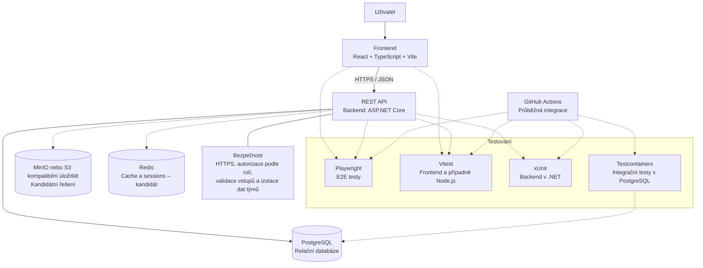

# 6.2 Technologický návrh systému StudentFlow

## 1. Účel dokumentu

Tento dokument popisuje navržené technologické řešení systému StudentFlow. Uvádí technologie využívané v jednotlivých částech aplikace, jejich zamýšlené využití a důvody jejich výběru.

Cílem je zvolit vhodné technologie pro vývoj webové aplikace určené ke správě studentských týmových projektů. Návrh zohledňuje současnou strukturu repozitáře, požadavky systému, možnosti automatizovaného testování a potřebu zabezpečení dat jednotlivých týmů.

Dokument zároveň rozlišuje mezi již zvolenými technologiemi a možnostmi, o kterých tým dosud nerozhodl.

## 2. Přehled technologií

| Oblast | Technologie | Stav rozhodnutí |
| :--- | :--- | :--- |
| Frontend | React | Zvoleno |
| Programovací jazyk frontendu | TypeScript | Zvoleno |
| Vývoj a sestavení frontendu | Vite | Zvoleno |
| Komunikace mezi frontendem a backendem | REST API, HTTPS, JSON | Zvoleno jako směr řešení |
| Backend | ASP.NET Core | Zatím nerozhodnuto |
| Databáze | PostgreSQL | Zvoleno |
| Úložiště souborů | MinIO nebo jiné S3 kompatibilní úložiště | Kandidátní řešení |
| Cache a sessions | Redis | Kandidát |
| E2E testování | Playwright | Navrženo |
| Jednotkové a integrační testování | Vitest nebo xUnit podle použité technologie | Výběr závisí na backendu a testované části |
| Databázové integrační testy | Testcontainers | Navrženo |
| Průběžná integrace | GitHub Actions | Využije se pro automatizaci kontrol a testů |
| Vývojové prostředí | Docker a případně Docker Compose | Podle potřeb týmu |

Konečné rozhodnutí o dosud otevřených technologiích bude provedeno před jejich rozsáhlejším nasazením do implementace.

## 3. Diagram technologického řešení

Diagram zobrazuje hlavní technologie a jejich vztahy. Plné šipky představují hlavní provozní komunikaci aplikace. Přerušované šipky znázorňují volitelné komponenty nebo vazby související s testováním.

PostgreSQL je zvolenou databází. MinIO nebo jiné S3 kompatibilní úložiště a Redis zůstávají kandidátními řešeními. Volba backendové technologie zatím není definitivní; podle konečného rozhodnutí se upraví také odpovídající testovací nástroje.

## 4. Frontend

### 4.1 React

React bude využit pro tvorbu uživatelského rozhraní aplikace StudentFlow. Umožňuje rozdělit rozhraní na samostatné a opakovaně použitelné komponenty, což usnadňuje implementaci i údržbu.

V systému bude zajišťovat zobrazování projektů, týmů, úkolů, komentářů a dalších informací. Umožní také vytvářet formuláře, přehledy a interaktivní prvky.

React byl zvolen také proto, že frontendová aplikace je již v této technologii založena. Její zachování omezuje zbytečné náklady spojené s přechodem na jiný framework.

### 4.2 TypeScript

TypeScript bude hlavním programovacím jazykem frontendu. Rozšiřuje JavaScript o statickou typovou kontrolu, která pomáhá odhalovat některé chyby již během vývoje.

V projektu bude využit pro implementaci komponent, definování datových struktur a práci s odpověďmi REST API. Typy pomohou sjednotit očekávanou podobu dat a usnadní spolupráci členů týmu.

TypeScript bude využit také při případné volbě backendu Node.js, protože umožňuje používat stejný jazyk na klientské i serverové straně.

### 4.3 Vite

Vite bude sloužit jako nástroj pro vývoj a sestavení frontendové aplikace. Poskytuje vývojový server s rychlou aktualizací změněného kódu a připravuje optimalizované sestavení pro nasazení.

Byl zvolen jako součást již vytvořeného frontendového projektu. Umožňuje rychlý vývoj a nevyžaduje zavádění dalšího nástroje pro sestavení aplikace.

## 5. Backend a REST API

### 5.1 REST API

REST API bude tvořit rozhraní mezi frontendovou a serverovou částí aplikace. Frontend prostřednictvím něj odešle požadavek na vytvoření, načtení, změnu nebo odstranění dat a backend vrátí odpovídající odpověď.

Komunikace bude využívat standardní HTTP metody, například:

- `GET` – načtení dat,
- `POST` – vytvoření záznamu,
- `PUT` nebo `PATCH` – změna existujících dat,
- `DELETE` – odstranění záznamu.

Data budou předávána ve formátu JSON. REST API umožní oddělit uživatelské rozhraní od implementace serverových funkcí, takže se obě části mohou vyvíjet samostatně při zachování dohodnutého rozhraní.

### 5.2 Volba backendové technologie

Konečná technologie backendu zatím není vybrána. Zvažují se dvě varianty: Node.js a ASP.NET Core.

**Varianta A – Node.js**

Node.js umožňuje vytvářet serverové aplikace v JavaScriptu, případně s využitím TypeScriptu. Jeho výhodou je možnost používat TypeScript na frontendu i backendu, sjednotit část vývojových nástrojů a sdílet některé datové typy.

Tato varianta vyžaduje výběr konkrétního backendového frameworku a návrh struktury serverové aplikace. Pokud by tým zvolil Node.js, bylo by nutné odpovídajícím způsobem upravit současnou strukturu backendových projektů a jejich testování.

**Varianta B – ASP.NET Core Web API**

ASP.NET Core umožňuje vytvářet webová API v jazyce C#. Podporuje zpracování HTTP požadavků, validaci, autentizaci, autorizaci a integraci s databázovými technologiemi.

Výhodou této varianty je skutečnost, že v současném repozitáři již existuje základ backendu rozdělený do projektů `StudentFlow.Api`, `StudentFlow.Core` a `StudentFlow.Data`. K dispozici jsou také samostatné testovací projekty pro .NET a framework xUnit.

Volba ASP.NET Core by proto umožnila navázat na připravenou strukturu bez nutnosti nahrazovat backend jinou technologií.

**Kritéria konečného rozhodnutí**

Při výběru backendové technologie bude tým zohledňovat zejména:

- zkušenosti členů týmu s danou technologií,
- možnost využít již připravenou strukturu repozitáře,
- návaznost na PostgreSQL a úložiště souborů,
- podporu automatizovaného testování,
- jednoduchost údržby, zabezpečení a dalšího rozvoje aplikace.

Dokud nebude rozhodnutí potvrzeno, budou Node.js a ASP.NET Core vedeny jako alternativy, nikoli jako současně používané backendové technologie.

## 6. Databáze

### 6.1 PostgreSQL

Pro ukládání strukturovaných dat systému StudentFlow byla zvolena relační databáze PostgreSQL.

Systém bude pracovat s propojenými údaji o uživatelích, rolích, týmech, projektech, úkolech a dalších souvisejících objektech. Relační databáze umožňuje tyto vztahy zachytit prostřednictvím tabulek, primárních a cizích klíčů a integritních omezení.

PostgreSQL byl zvolen z následujících důvodů:

- podporuje relační datový model vhodný pro strukturované a vzájemně propojené informace,
- podporuje transakce, které pomáhají zachovat konzistenci dat při změnách,
- je dostupný jako open-source databázový systém,
- lze jej provozovat ve vývojovém i nasazeném prostředí,
- je možné jej integrovat s backendem v Node.js i ASP.NET Core.

Datový model bude navržen s ohledem na vazby mezi entitami a především na oprávnění uživatelů přistupovat k datům svých týmů.

### 6.2 Přístup k databázi

Způsob přístupu k PostgreSQL bude záviset na konečné volbě backendu.

Pokud bude zvoleno ASP.NET Core, lze využít Entity Framework Core jako objektově-relační mapovací nástroj (ORM). Ten umožňuje pracovat s databázovými záznamy prostřednictvím tříd a objektů v C# a podporuje správu databázového schématu pomocí migrací.

Pokud bude zvolen Node.js, tým vybere odpovídající knihovnu nebo ORM kompatibilní s PostgreSQL a TypeScriptem.

V obou případech bude přístup k databázi oddělen od ostatních částí aplikace, aby bylo možné lépe testovat datové operace a udržovat kód.

## 7. Úložiště souborů

### 7.1 MinIO nebo S3 kompatibilní úložiště

Pro soubory nahrávané do systému se zvažuje MinIO nebo jiné úložiště kompatibilní s rozhraním Amazon S3.

Objektové úložiště je vhodné pro soubory, jako jsou přílohy projektů, dokumenty a další uživatelský obsah. Umožní oddělit samotné soubory od strukturovaných dat uložených v PostgreSQL.

Databáze bude uchovávat především metadata souborů, například název, typ, identifikátor úložiště, vazbu na projekt a informace o vlastníkovi či týmu. Samotný obsah souboru bude uložen v objektovém úložišti.

Kandidátní řešení bude vyhodnoceno podle snadnosti nasazení, dostupnosti potřebných funkcí, zabezpečení přístupu a vhodnosti pro rozsah projektu.

Přístup k souborům bude řízen backendem. Uživatel nebude smět získat přístup k souboru jiného týmu pouze na základě znalosti jeho identifikátoru.

## 8. Cache a sessions

### 8.1 Redis

Redis je zvažován jako možné řešení pro ukládání dočasných dat, cachování často používaných informací a případnou správu sdílených sessions.

Cache by mohla snížit počet opakovaných databázových dotazů a urychlit načítání často používaných údajů. Sdílené sessions mohou být užitečné, pokud bude aplikace používat session-based autentizaci a bude potřeba uchovávat session stav mimo proces backendu.

Redis však není nezbytnou součástí první verze aplikace. Jeho zavedení bude záviset na zvoleném způsobu autentizace, skutečných požadavcích na výkon a složitosti řešení.

Pokud se ukáže, že aplikace Redis nepotřebuje, nebude přidáván pouze kvůli rozšiřování technologického stacku.

## 9. Testování

Testování bude rozděleno podle účelu na jednotkové, integrační a end-to-end testy.

### 9.1 Playwright – end-to-end testování

Playwright bude využit pro automatizované end-to-end (E2E) testování webové aplikace prostřednictvím prohlížeče.

Umožní ověřovat celé uživatelské scénáře, například přihlášení, vytvoření projektu, přidání člena do týmu nebo práci s úkoly. Tím prověří spolupráci frontendu a backendu z pohledu uživatele.

Playwright byl navržen proto, že testuje aplikaci prostřednictvím jejího skutečného uživatelského rozhraní a dokáže odhalovat problémy, které samotné jednotkové testy jednotlivých komponent nemusí zachytit.

### 9.2 Vitest a xUnit – jednotkové a integrační testy

Konkrétní testovací framework bude vybrán podle použité technologie a testované části aplikace.

**Vitest** je určen pro projekty v JavaScriptu a TypeScriptu. Bude vhodný zejména pro testování frontendových komponent a funkcí. Pokud bude zvolen backend v Node.js, lze jej případně využít také pro testování serverového kódu.

**xUnit** je framework pro automatizované testování aplikací v prostředí .NET. Pokud bude zvolen ASP.NET Core, bude vhodný pro testování backendových projektů, včetně doménové logiky a dalších funkcí serveru.

Výběr testovacího frameworku se proto odvíjí od konečného rozhodnutí o backendu. Není nutné používat Vitest i xUnit pro stejnou část systému.

### 9.3 Testcontainers – databázové integrační testy

Testcontainers umožňuje spouštět závislé služby v izolovaných kontejnerech pro účely testování. V systému StudentFlow se navrhuje využít jej pro integrační testy, které potřebují skutečnou instanci PostgreSQL.

Tím bude možné ověřovat reálné databázové operace, ukládání a načítání dat, integritu záznamů a chování datové vrstvy bez nutnosti používat sdílenou vývojovou databázi.

Testcontainers bude zároveň možné využít v automatizovaném testování na CI, pokud bude pro běh testů dostupné odpovídající kontejnerové prostředí.

## 10. Infrastruktura a průběžná integrace

### 10.1 Git a GitHub

Git bude využit pro správu verzí zdrojového kódu. Umožní sledovat změny, vytvářet větve, slučovat práci jednotlivých členů týmu a vracet se k předchozím verzím.

GitHub bude sloužit jako společné úložiště zdrojového kódu a dokumentace. Podpoří týmovou spolupráci, kontrolu změn a propojení vývoje s automatizovaným testováním.

### 10.2 GitHub Actions

GitHub Actions bude využit pro průběžnou integraci (CI). Umožní automaticky spouštět definované kontroly při změnách v repozitáři.

Workflow v souboru `.github/workflows/ci.yml` bude nastaven tak, aby podle konečného technologického řešení ověřoval sestavení aplikace a spouštěl odpovídající testy.

Do CI se navrhuje zahrnout zejména:

- sestavení backendu nebo serverové aplikace,
- sestavení frontendu,
- automatizované jednotkové a integrační testy,
- E2E testy,
- testy vyžadující PostgreSQL prostřednictvím Testcontainers.

Automatizace pomůže odhalovat chyby průběžně a omezí riziko, že se do společné větve dostanou nefunkční změny.

### 10.3 Docker a Docker Compose

Docker lze využít pro spuštění podpůrných služeb ve vývojovém prostředí, například PostgreSQL a případně objektového úložiště nebo Redis.

Docker Compose může sjednotit konfiguraci a spuštění těchto služeb napříč vývojovými prostředími jednotlivých členů týmu.

Docker bude rovněž relevantní pro běh databázových testů prostřednictvím Testcontainers. Rozsah jeho využití při běžném spouštění celé aplikace zatím není nutné definitivně stanovit.

## 11. Bezpečnost

Bezpečnost je důležitou součástí technologického návrhu, protože systém bude zpracovávat uživatelské účty, týmová data, projekty a případné přílohy.

### 11.1 HTTPS

Při nasazení aplikace bude komunikace mezi klientem a serverem chráněna pomocí HTTPS. Šifrované spojení pomůže chránit přenášená data před odposlechem a neoprávněnou změnou během přenosu.

### 11.2 Autentizace a autorizace podle rolí

Systém bude ověřovat identitu uživatele a řídit přístup k funkcím podle jeho role. Oprávnění budou kontrolována na straně backendu, nikoli pouze skrytím prvků v uživatelském rozhraní.

Autentizace bude sloužit k ověření identity uživatele, zatímco autorizace určí, jaké operace může provádět.

Konkrétní způsob implementace autentizace bude navržen s ohledem na zvolenou backendovou technologii.

### 11.3 Validace vstupních dat

Backend bude validovat vstupy od uživatelů před jejich dalším zpracováním a uložením do databáze. Validace ve frontendu zlepší uživatelský komfort, ale nebude považována za náhradu serverové kontroly.

U souborů bude podle požadavků systému potřeba ověřovat například povolené typy, velikost a oprávnění uživatele k jejich nahrávání.

### 11.4 Izolace dat mezi týmy

Jedním z hlavních bezpečnostních požadavků je zabránit tomu, aby člen jednoho týmu získal neoprávněný přístup k datům jiného týmu.

Backend bude při práci s projekty, úkoly, soubory a dalšími týmovými objekty ověřovat, zda má přihlášený uživatel k danému objektu odpovídající oprávnění.

Kontrola bude provedena při každém relevantním požadavku. Nestačí spoléhat pouze na identifikátory posílané klientem ani na omezení viditelnosti dat ve frontendu.

## 12. Otevřená technologická rozhodnutí

Před dokončením technologického řešení musí tým potvrdit následující body:

1. **Backend:** rozhodnout mezi Node.js a ASP.NET Core. Stávající struktura repozitáře poskytuje výhodu variantě ASP.NET Core, protože již obsahuje základ backendu a testovacích projektů.
2. **Úložiště souborů:** vybrat mezi MinIO a jiným S3 kompatibilním řešením podle potřeb provozu, způsobu nasazení a zabezpečení.
3. **Redis:** rozhodnout, zda je cache nebo sdílená session vrstva nezbytná již v první verzi aplikace.
4. **Testovací framework backendu:** po výběru backendu potvrdit použití xUnit nebo vhodného frameworku v ekosystému Node.js.
5. **Kontejnerové prostředí:** určit, zda se Docker Compose použije pro lokální provoz podpůrných služeb.

Tato rozhodnutí by měla být provedena před rozsáhlejší implementací příslušných částí systému, aby se omezila potřeba pozdějších zásadních změn.

## 13. Zdůvodnění celkového technologického řešení

Navržené technologie pokrývají hlavní potřeby systému StudentFlow. React, TypeScript a Vite tvoří základ uživatelského rozhraní. REST API zajišťuje oddělení frontendu od backendu a PostgreSQL poskytuje relační úložiště pro strukturovaná data systému.

Pro soubory se zvažuje objektové úložiště, které oddělí obsah souborů od databázových metadat. Redis zůstává volitelnou komponentou a bude zaveden pouze tehdy, pokud bude jeho přínos odpovídat požadavkům aplikace.

Playwright umožní ověřovat celé uživatelské scénáře, zatímco Vitest nebo xUnit budou použity pro jednotkové a integrační testy podle zvolené technologie. Testcontainers pomůže ověřovat chování aplikace při práci se skutečnou databází. GitHub Actions umožní automatizovat sestavení a testování při změnách v repozitáři.

Samostatnou pozornost návrh věnuje zabezpečení přístupu podle rolí, validaci vstupních dat a izolaci dat jednotlivých týmů. Tato opatření jsou zásadní pro ochranu soukromých údajů a obsahu týmových projektů.

## 14. Shrnutí

Technologický návrh StudentFlow vychází ze zvoleného frontendu React, TypeScript a Vite, relační databáze PostgreSQL a komunikace prostřednictvím REST API.

Backendová technologie zatím není definitivně vybrána. Kandidáty jsou Node.js a ASP.NET Core, přičemž současná struktura repozitáře je již připravena pro ASP.NET Core. Další otevřená rozhodnutí se týkají objektového úložiště souborů, Redis a přesného rozdělení testovacích nástrojů.

Playwright, Vitest nebo xUnit a Testcontainers vytvoří základ pro testování na různých úrovních. GitHub Actions podpoří průběžné ověřování změn. Bezpečnostní řešení bude zahrnovat HTTPS, autorizaci podle rolí, validaci vstupů a ochranu dat mezi týmy.

Návrh tak stanovuje technologický základ projektu a současně transparentně uvádí oblasti, ve kterých je před dokončením implementačního návrhu nutné rozhodnutí celého týmu.

## 15. Použité zdroje

- React – oficiální dokumentace: https://react.dev/
- TypeScript – oficiální dokumentace: https://www.typescriptlang.org/docs/
- Vite – oficiální dokumentace: https://vite.dev/guide/
- Node.js – oficiální dokumentace: https://nodejs.org/docs/
- ASP.NET Core Web API – oficiální dokumentace: https://learn.microsoft.com/en-us/aspnet/core/web-api/
- PostgreSQL – oficiální dokumentace: https://www.postgresql.org/docs/
- Entity Framework Core – oficiální dokumentace: https://learn.microsoft.com/en-us/ef/core/
- MinIO – oficiální dokumentace: https://min.io/docs/
- Redis – oficiální dokumentace: https://redis.io/docs/latest/
- Playwright – oficiální dokumentace: https://playwright.dev/docs/intro
- Vitest – oficiální dokumentace: https://vitest.dev/guide/
- xUnit – oficiální dokumentace: https://xunit.net/
- Testcontainers – dokumentace pro .NET: https://dotnet.testcontainers.org/
- GitHub Actions – oficiální dokumentace: https://docs.github.com/en/actions
- Docker Compose – oficiální dokumentace: https://docs.docker.com/compose/
