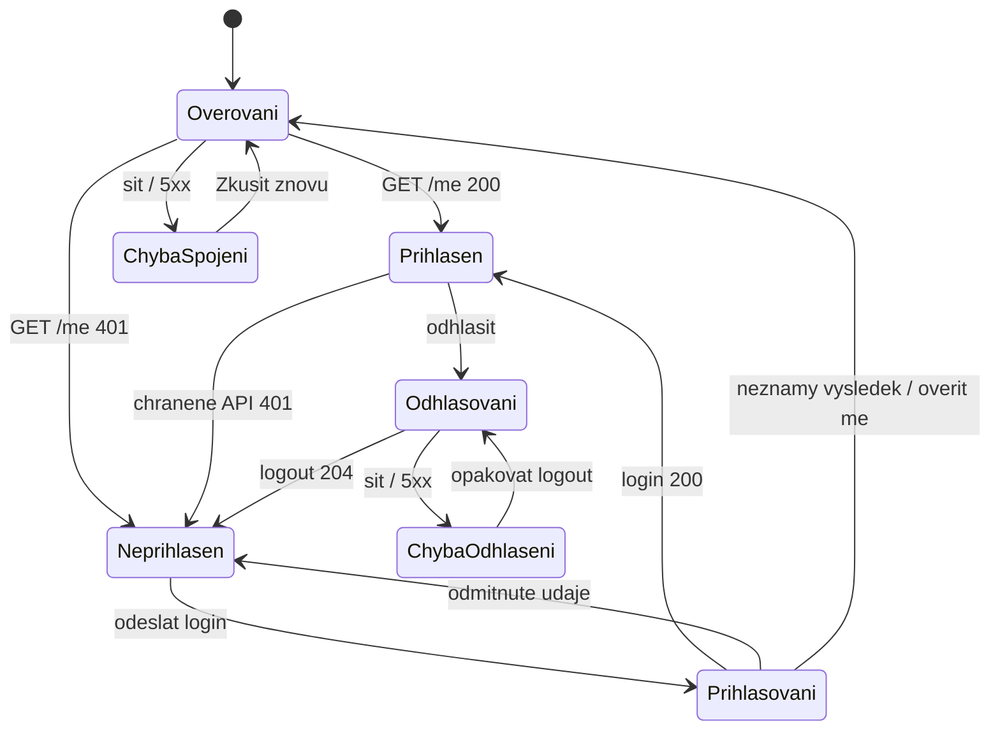

# KAN-101 / KAN-102: obrazovky, stavy a přechody

**Autentizační průchod je implementovaný. Zdrojem pravdy pro stávající
obrazovky je původní [Wireframe.pdf](../Wireframe.pdf):** přihlášení na straně 3,
registrace na straně 4 a rozcestníky na stranách 5 a 7.
[PDF doplňků](auth-wireframes.pdf) a upravitelné SVG
([mobil](auth-mobile.svg), [stavy a odhlášení](auth-states.svg)) obsahují pouze
nepokryté šířky a podrobné stavy. Následující text zpřesňuje implementované
chování a již schválená pravidla bez dalšího desktopového wireframu.
Ukázkové identity a obsah rozcestníku nejsou skutečná data ani implementace KAN-47.

## Obrazovky a formuláře

| Cesta | Obsah | Akce |
| :--- | :--- | :--- |
| `/register` | Jméno a příjmení, e-mail, heslo, heslo znovu, radio tlačítka Člen a Vyučující. Všechna pole povinná, právě jeden typ. | „Vytvořit účet“ → `POST /register` → při `201` login s potvrzením. Odkaz „Přihlaste se“. |
| `/login` | E-mail, heslo, volitelně „Zůstat přihlášen“. Nápověda „Přihlášení až na 30 dní na tomto zařízení“. | „Přihlásit se“ → `POST /login` → rozcestník podle typu účtu. Odkaz „Zaregistrujte se“. |
| `/projects` | Hlavička s identitou a logoutem, pohled člena. | Pro typ Člen; bez přepínání typu účtu. Obsah dodá KAN-47. |
| `/teaching` | Stejná hlavička, pohled vyučujícího. | Pro typ Vyučující; bez přepínání typu účtu. Obsah dodá KAN-47. |

API cesty jsou zkrácené; prefix je `/api/auth`. Hlavička obsahuje jméno z `/me`,
typ účtu, odkaz na vlastní rozcestník a „Odhlásit se“. Na mobilu se zalomí;
žádná akce nevyžaduje hover. Přepínač mezi členem a vyučujícím se nenabízí.
Přihlášený uživatel na `/login` či `/register` pokračuje na výchozí rozcestník.
Přímá chráněná adresa nejdříve čeká na `/me`. Nemá-li přihlášený uživatel typ
potřebný pro stránku, dostane vysvětlení a odkaz na dostupný pohled, nikoli login.

### Detaily formulářů

- Nápověda hesla: „15–128 znaků. Můžete použít mezery i delší heslovou frázi.“
- Heslo znovu se porovnává přesně; rozdíl: „Hesla se neshodují.“ API dostane jen
  `password`. Každé heslové pole má vlastní přepínač Zobrazit/Skrýt.
- Typ účtu je `fieldset` s legendou a dvěma radio tlačítky stejné skupiny
  `accountType`. Výchozí stav je bez výběru, výběr je povinný. Chyba:
  „Vyberte typ účtu: Člen, nebo Vyučující.“ Volba jedné možnosti zruší druhou.
  Ve skupině fungují také šipky klávesnice. Popisky vysvětlují jednotlivé typy;
  vyučující přístup k projektům teprve dostává.
  Vedoucí týmu ani administrátor se při registraci nenabízí.
- Jméno: `autocomplete=name`; e-mail: `type=email`, `autocomplete=username`,
  bez automatických velkých písmen. Heslo: `new-password` při registraci,
  `current-password` při loginu. Vložení ze schránky i správce hesel jsou povolené.
- Po neúspěchu zachovat jméno, e-mail a zvolený typ účtu. Hesla po dokončeném neúspěšném
  pokusu vymazat; při lokální kontrole před odesláním zůstanou pro opravu.
  Při přechodu jinam se vždy odstraní.
- Enter odesílá. Během odesílání nelze vytvořit druhý požadavek. Přepínač
  viditelnosti hesla není submit tlačítko.

## Stav identity a přechody

| Stav / událost | Co uživatel uvidí | Následující chování |
| :--- | :--- | :--- |
| Počáteční ověřování | „Ověřujeme přihlášení…“, bez soukromého obsahu. | Počkat na `/me`, teprve pak stránka nebo login. |
| Chyba ověření | „Přihlášení se nepodařilo ověřit. Zkontrolujte připojení a zkuste to znovu.“ | „Zkusit znovu“. Chyba se nevydává za nepřihlášený stav. |
| Probíhá registrace / login | „Vytváříme účet…“ / „Přihlašujeme…“, zaneprázdněný formulář. | Jeden požadavek, bez předčasného úspěchu nebo přesměrování. |
| Lokální chyba / `400` | Souhrn a chyby u polí. | Fokus na souhrn s odkazy na pole. |
| Registrace `409` | „Účet s tímto e-mailem už existuje. Přihlaste se.“ | Chyba u e-mailu, odkaz na login. |
| Registrace `201` | Login: „Účet byl vytvořen. Nyní se přihlaste.“ | E-mail z paměti, heslo prázdné; bez automatické session. |
| Login `401` | „E-mail nebo heslo nejsou správné.“ | Nerozlišovat neexistující/neaktivní účet; zachovat e-mail. |
| `429` | „Příliš mnoho pokusů. Zkuste to znovu za …“ | Respektovat `Retry-After`, poté akce uživatele. |
| `403 CSRF_INVALID` | Během jedné obnovy zůstává stav odesílání. | Při opakované chybě výzva k opakování, bez smyčky. |
| Síť / `5xx` při zápisu | „Operaci se nepodařilo potvrdit.“ | Neopakovat automaticky. Registrace nabídne login, login bezpečné ověření `/me`. |
| Session již neplatí | Login: „Přihlášení již neplatí. Přihlaste se znovu.“ | Po `401` odstranit identitu, token, privátní cache i čekající výsledky starých požadavků. |
| Projektové `403` | „K tomuto projektu nemáte přístup.“ | Neodhlašovat; nabídnout rozcestník. |
| Logout probíhá | „Odhlašujeme…“, soukromý obsah již skrytý. | Zablokovat soukromé akce a zrušit čekající požadavky. |
| Logout `204` | Login: „Byli jste odhlášeni.“ | Odstranit identitu a privátní cache; stará cookie již nefunguje. |
| Logout síť / `5xx` | „Odhlášení se nepodařilo potvrdit. Zkuste to znovu.“ | Soukromý obsah zůstane skrytý; nabídnout opakování logoutu, nehlásit úspěch. |

Odpojení během práce samo neprokazuje expiraci. UI přestane potvrzovat zápisy
a ukáže chybu spojení. Při návratu do aplikace se identita znovu ověří; do té
doby je chráněný obsah zakrytý. Opožděná odpověď z doby před logoutem nebo změnou
uživatele nesmí znovu naplnit privátní cache.

## Responzivita a přístupnost

- Desktop: formulářová karta nejvýše 448 CSS px, vycentrovaná. Mobil: celá
  dostupná šířka s odsazením, přirozené svislé rolování.
- Tabletové rozložení při šířce 704–1199 CSS px (44–75 rem při základním písmu
  16 px): registrační karta nejvýše 640 px, dvojice jméno/e-mail a heslo/opakování
  ve dvou sloupcích. Volby Člen/Vyučující jsou vedle sebe, odeslání přes celou
  šířku. Pořadí polí při ovládání klávesnicí zůstává stejné.
- Přihlášení má na tabletu kartu nejvýše 544 px a pole pod sebou. Přihlášený
  přehled má identitu vlevo a navigaci s odhlášením vpravo; dlouhé jméno se zalamuje.
  Při otočení zařízení se použije dostupná šířka, bez pevné výšky formuláře.
- Bez pevné výšky blokující pole při otevřené klávesnici. Při 320 CSS px a 200%
  zvětšení se pole, nápovědy i hlavička zalamují bez překryvů.
- Viditelné popisky a fokus; Tab/Shift+Tab/Enter/mezerník. Dotykové cíle alespoň
  44 × 44 CSS px; volby typu účtu i checkbox „Zůstat přihlášen“ mají klikací celý popisek.
- Chyby také textem, ne jen barvou; `aria-describedby` a `aria-invalid`.
  Stavové zprávy mají živou oblast; odpočet neoznamuje každou sekundu.
- Změna stránky přesouvá fokus na nadpis; souhrn chyb je dosažitelný klávesnicí.

## Scénáře pro validaci a následnou implementaci

| ID | Scénář | Očekávaný výsledek |
| :--- | :--- | :--- |
| A01 | Registrace Člen / Vyučující. | Každá varianta vede na login; vybrat lze právě jednu, vedení týmu se nenabízí. |
| A02 | Žádný typ, kombinace/pole typů v API, různá hesla, heslo 14/129 znaků. | Chyby ve formuláři nebo `400` v API; délky 15/128 projdou. |
| A03 | E-mail s mezerami a jinou velikostí písmen. | Jeden normalizovaný účet, duplicita `409`. |
| A04 | Neexistující/neaktivní účet či špatné heslo. | Shodné `401` bez potvrzení existence účtu. |
| A05 | Login bez/s „Zůstat přihlášen“. | Absolutní 8 h / 30 dní; `/me` expiraci neprodlužuje. |
| A06 | Refresh a přímá chráněná URL s platnou/neplatnou session. | Bez probliknutí dat; správné ověření nebo login. |
| A07 | Člen / vyučující po loginu a refreshi. | `/projects` / `/teaching`; identita má právě jeden typ, přepínač se nenabízí. |
| A08 | Logout a znovupoužití původní cookie. | Po `204` API cookie odmítne, tlačítko Zpět neodhalí data. |
| A09 | Výpadek API při ověření, registraci, loginu, logoutu. | Žádný falešný úspěch či záměna chyby spojení za `401`. |
| A10 | Chybějící/starý CSRF token a limit pokusů. | `403` / `429`, nejvýše jedna obnova tokenu. |
| A11 | Vyučující otevře cizí projekt nebo pohled člena, člen pohled vyučujícího. | Žádné rozšíření přístupu typem účtu; `403` neodhlásí. |
| A12 | Šířky 320, 390, 744, 768, 820, 1024, 1180 a 1440 px, klávesnice, dotyk a otočení tabletu. | Celý průchod bez překryvů či vodorovného posunu formulářů; po zmenšení viditelné výšky lze formulář posunout k odeslání. |

Scénáře jsou podklady pro KAN-111/112. Návrhový krok nenahrazuje jejich skutečné
provedení proti implementované aplikaci.
