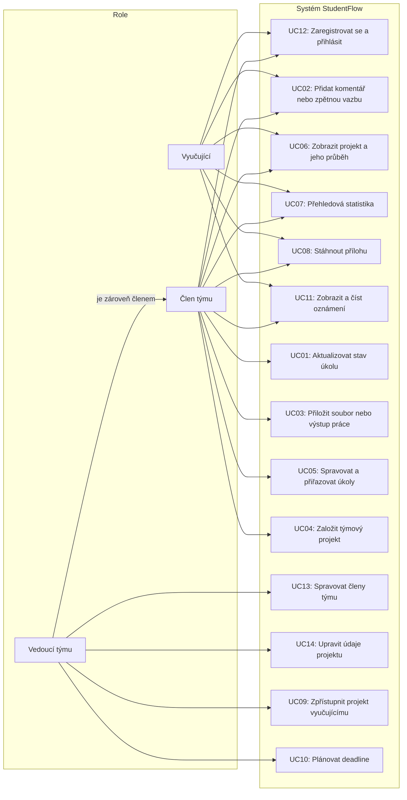

# 4.7 Use Case – případy užití

> **Krok 5 řetězce: případy užití.** Navazuje na [požadavky](REQUIREMENTS.md), pokračuje návrhem: [wireframy](../ELABORATION/Wireframe.pdf), [ER model](../ELABORATION/StudentFlow_ER.svg) a podrobnými návrhy v [auth](../ELABORATION/auth/README.md) a [projects](../ELABORATION/projects/MEMBERS.md).

Každý případ užití uvádí funkční požadavky (FP), ze kterých vychází. Případy užití popisují cílový stav celého systému. Které z nich už pokrývá prototyp (20 % implementace), uvádí [dokument o prototypu](../ELABORATION/PROTOTYP.md).

## Diagram případů užití

UC04 spouští člen týmu: kdo projekt založí, stává se jeho vedoucím.

# Přehled případů užití (Use Cases)

## UC01 Aktualizovat stav úkolu
* **Požadavky:** FP08, FP02
* **Role:** Člen týmu, vedoucí týmu
* **Cíl:** Sdílet aktuální průběh práce na přiděleném úkolu.
* **Vstup:** Úkol existuje. Člen mění svůj přidělený úkol; vedoucí kterýkoli úkol svého týmu.
* **Průběh:**
  1. Uživatel přetáhne úkol na nástěnce do jiného sloupce (na mobilu vybere cílový sloupec).
  2. Systém ověří oprávnění.
  3. Uloží nový stav a pořadí úkolu a aktualizuje nástěnku.
* **Rozšíření (letní semestr):** Systém ke změně uloží záznam do historie s autorem a časem, vytvoří oznámení (UC11) a při souběžné změně upozorní na konflikt s možností načíst aktuální verzi.
* **Výjimky:** Přesun cizího úkolu členem nebo jakýkoli přesun vyučujícím systém odmítne. Když se změna neuloží, úkol se vrátí na původní místo a uživatel dostane srozumitelnou hlášku.
* **Výsledek:** Tým vidí nový stav úkolu. Změna stavu sama neznamená přijetí řešení.

---

## UC02 Přidat komentář nebo zpětnou vazbu
* **Požadavky:** FP09
* **Role:** Člen týmu, vedoucí týmu, vyučující
* **Cíl:** Uchovat dotaz nebo připomínku u správného projektu, úkolu či verze řešení.
* **Vstup:** Uživatel má přístup k cílovému objektu. Vyučující má k projektu přístup podle UC09.
* **Průběh:**
  1. Uživatel otevře projekt, úkol nebo konkrétní verzi a napíše komentář.
  2. Vyučující může k připomínce doplnit prioritu nebo termín opravy a posoudit odevzdaný výstup; jde o údaje zpětné vazby.
  3. Systém ověří vstup a přístup, uloží autora, čas a vazbu na objekt; komentář zobrazí oprávněným uživatelům a případně je upozorní.
* **Výjimky:** Prázdný nebo příliš dlouhý text se odmítne. Při ztrátě přístupu se komentář neuloží. Uživatelský vstup se bezpečně zobrazí.
* **Výsledek:** Je zřejmé, čeho se komentář týká; komentář sám nemění zadání ani stav úkolu.

---

## UC03 Přiložit soubor nebo výstup práce
* **Požadavky:** FP10, NP05
* **Role:** Člen týmu, vedoucí týmu
* **Cíl:** Sdílet podklady projektu a odevzdat konkrétní výstup úkolu.
* **Vstup:** Uživatel má právo přidat přílohu k projektu nebo úkolu.
* **Průběh:**
  1. Uživatel vybere soubor u projektu nebo úkolu. U odevzdání řešení vybere příslušný úkol.
  2. Systém ověří přístup, povolený typ a maximální velikost souboru (20 MB).
  3. Uloží přílohu; odevzdaný výstup úkolu eviduje jako samostatnou verzi s autorem, časem a počátečním posouzením Neposouzeno.
* **Výjimky:** Nevhodný soubor odmítne. Neúspěšný přenos nevytvoří dostupnou přílohu a umožní opakování. Oprava je novou verzí.
* **Výsledek:** Soubor lze stáhnout podle UC08. Původní verze i její komentáře a posouzení zůstávají zachovány.

---

## UC04 Založit týmový projekt
* **Požadavky:** FP03, FP04
* **Role:** Přihlášený člen týmu (založením se stává vedoucím)
* **Cíl:** Vytvořit společný prostor pro studentský projekt a jeho tým.
* **Vstup:** Uživatel má účet typu Člen.
* **Průběh:**
  1. Uživatel zadá název, popis a plánovaný termín projektu.
  2. Vyplní název nového týmu a potvrdí vytvoření.
  3. Systém ověří údaje, společně vytvoří projekt a tým, přiřadí zakladatele jako vedoucího a zobrazí nástěnku projektu.
* **Výjimky:** Chybějící či neplatné údaje musí uživatel opravit. Účet typu Vyučující projekt nezakládá. Při selhání ukládání nesmí vzniknout neúplný projekt bez týmu.
* **Výsledek:** Projekt je propojený s týmem a jeho vedoucím.

---

## UC05 Spravovat a přiřazovat úkoly
* **Požadavky:** FP05, FP06, FP07
* **Role:** Člen a vedoucí týmu
* **Cíl:** Rozdělit práci s jasným zadáním, odpovědností, termínem a prioritou.
* **Vstup:** Uživatel je členem nebo vedoucím příslušného projektu.
* **Průběh:**
  1. Zvolí vytvoření nového úkolu nebo úpravu existujícího.
  2. Zadá či upraví název, popis, termín, prioritu a řešitele. Vedoucí vybere řešitele z celého týmu, člen může úkol přiřadit jen sobě.
  3. Systém ověří povinné údaje a členství, uloží změnu a zobrazí úkol na nástěnce; nový úkol má výchozí stav.
* **Výjimky:** Úkol nelze přiřadit člověku mimo tým. Člen nemůže přiřadit úkol jinému členovi. Neplatné nebo chybějící povinné údaje brání uložení.
* **Výsledek:** Úkol je vytvořen či upraven a má stanovené podmínky plnění. Samostatná změna stavu patří do UC01.

---

## UC06 Zobrazit projekt a jeho průběh
* **Požadavky:** FP08, FP11, FP13
* **Role:** Člen týmu, vedoucí týmu, vyučující
* **Cíl:** Zjistit zadání projektu, stav práce, termíny a případná zpoždění.
* **Vstup:** Uživatel má přístup k projektu; pro vyučujícího platí vazba podle UC09.
* **Průběh:**
  1. Uživatel otevře seznam dostupných projektů a vybere projekt.
  2. Systém zobrazí základní informace, členy, Kanban úkolů, milníky, termíny a aktivitu; zvýrazní dostupné informace o nedokončené či opožděné práci.
  3. Uživatel filtruje úkoly nebo otevře detail s řešitelem, prioritou, přílohami, verzemi, komentáři a posouzeními včetně vyučujícího.
* **Výjimky:** Prázdný projekt zobrazí prázdný přehled. Neexistující či nepřístupný projekt se nezpřístupní ani přímým zadáním adresy.
* **Výsledek:** Uživatel má aktuální přehled. Zobrazení samo nemění projektová data.

---

## UC07 Přehledová statistika
* **Požadavky:** FP12
* **Role:** Člen týmu, vedoucí týmu, vyučující
* **Cíl:** Doložit rozdělení práce a zapojení jednotlivých členů týmu.
* **Vstup:** Systém eviduje řešitele, stav a termín úkolů a autorství a čas událostí projektu (rozšíření UC01).
* **Průběh:**
  1. Uživatel otevře přehled příspěvků a zvolí časové období.
  2. Systém u každého člena zobrazí počet přiřazených, dokončených a zpožděných úkolů a události přiřazené autorům, zejména komentáře, přílohy a změny stavů.
  3. Uživatel vybere člena a dohledá konkrétní úkoly a události, ze kterých souhrn vznikl.
* **Výjimky:** Období bez událostí má nulové hodnoty. Příspěvky bývalých členů zůstávají dohledatelné.
* **Výsledek:** Souhrn je ověřitelný z podkladů. Počet akcí nevyjadřuje hodiny ani kvalitu práce a neurčuje známku.

---

## UC08 Stáhnout přílohu
* **Požadavky:** FP10
* **Role:** Člen týmu, vedoucí týmu, vyučující
* **Cíl:** Získat sdílený soubor nebo konkrétní verzi výstupu pro práci či kontrolu.
* **Vstup:** Příloha existuje a uživatel má přístup k jejímu projektu nebo úkolu. U úkolu nezáleží na jeho Kanban stavu.
* **Průběh:**
  1. Uživatel otevře seznam příloh projektu nebo detailu úkolu.
  2. Vybere přílohu či konkrétní verzi řešení a zvolí stažení.
  3. Systém znovu ověří přístup k objektu i souboru a odešle soubor do zařízení uživatele.
* **Výjimky:** Bez příloh se zobrazí prázdný seznam. Neoprávněný přímý požadavek se odmítne; nedostupný nebo neotevíratelný výstup vyvolá chybu a možnost opakování.
* **Výsledek:** Soubor je stažen. Jeho uložený obsah ani stav úkolu se nemění.

---

## UC09 Zpřístupnit projekt vyučujícímu
* **Požadavky:** FP13, FP02
* **Role:** Vedoucí týmu
* **Cíl:** Udělit nebo odebrat konkrétnímu vyučujícímu přístup k projektu.
* **Vstup:** Vedoucí spravuje vlastní projekt. Cílový účet má typ Vyučující.
* **Průběh:**
  1. Vedoucí otevře nastavení svého projektu.
  2. Vybere vyučujícího a potvrdí udělení či odebrání přístupu.
  3. Systém ověří oprávnění a aktualizuje vazbu. Udělení zpřístupní přehledy, komentáře, soubory a posuzování řešení; odebrání přístup odvolá.
* **Výjimky:** Účet bez typu Vyučující nelze přiřadit. Duplicitní vazba nevznikne. Běžný člen ani vyučující přístup nespravují; vedoucí nespravuje cizí projekt.
* **Výsledek:** Přístup vyučujícího je aktualizovaný. Vyučující vidí jen projekty, ke kterým mu vedoucí přístup udělil.

---

## UC10 Plánovat deadline
* **Požadavky:** FP14, FP07
* **Role:** Vedoucí týmu
* **Cíl:** Stanovit kontrolní body a termíny důležitých částí projektu.
* **Vstup:** Projekt existuje a vedoucí má právo jej upravovat.
* **Průběh:**
  1. Vedoucí otevře plán projektu a vytvoří nebo vybere milník.
  2. Zadá či upraví název, popis, termín a případně související úkoly.
  3. Systém ověří údaje, uloží milník a zobrazí jej v plánu; případně upozorní členy týmu.
* **Výjimky:** Neplatný termín nebo rozpor s pravidly projektu vyžaduje opravu. Kolize s jiným plánem může vyvolat upozornění, ale uložení neblokuje.
* **Výsledek:** Milník a termín jsou dostupné oprávněným uživatelům v přehledu projektu.

---

## UC11 Zobrazit a číst oznámení
* **Požadavky:** FP15
* **Role:** Člen týmu, vedoucí týmu, vyučující
* **Cíl:** Získat přehled o změnách, komentářích, termínech a výsledcích kontrol.
* **Vstup:** Uživatel má oznámení odpovídající jeho projektům a oprávněním.
* **Průběh:**
  1. Uživatel otevře centrum oznámení.
  2. Systém zobrazí relevantní oznámení v rozsahu aktuálních oprávnění.
  3. Uživatel otevře oznámení, přejde na související projekt či úkol a může jej označit jako přečtené.
* **Výjimky:** Bez nových oznámení se zobrazí informace, že je vše aktuální. Odkaz nesmí obejít kontrolu přístupu k cílovému objektu.
* **Výsledek:** Uživatel se dostane k související aktivitě a může evidovat přečtení. Oznámení se zobrazují jen v aplikaci; e-mailová a push oznámení jsou mimo rozsah.

---

## UC12 Zaregistrovat se a přihlásit
* **Požadavky:** FP01, FP02, NP03, NP11
* **Role:** Člen týmu, vyučující (zatím nepřihlášený uživatel)
* **Cíl:** Získat účet a bezpečně se přihlásit do systému.
* **Vstup:** Uživatel nemá účet (registrace), nebo má aktivní účet (přihlášení).
* **Průběh:**
  1. Uživatel vyplní jméno, příjmení, e-mail a dvakrát heslo, zvolí typ účtu Člen, nebo Vyučující, a potvrdí zásady ochrany osobních údajů.
  2. Systém ověří údaje, uloží účet a přejde na přihlášení s předvyplněným e-mailem.
  3. Uživatel se přihlásí, případně zvolí „Zůstat přihlášen“. Systém vytvoří session a podle typu účtu otevře přehled člena, nebo přehled vyučujícího.
* **Výjimky:** Neplatné údaje, nesplněná pravidla hesla nebo chybějící souhlas brání registraci. Registrace na již použitý e-mail skončí neutrální hláškou, která existenci účtu nepotvrdí. Chybné přihlašovací údaje vedou k jedné společné hlášce. Odhlášení zneplatní session na serveru.
* **Výsledek:** Uživatel je přihlášen se správným typem účtu. Registrace sama nepřidává uživatele do žádného projektu.

---

## UC13 Spravovat členy týmu
* **Požadavky:** FP04, FP02
* **Role:** Vedoucí týmu (seznam členů vidí každý člen projektu)
* **Cíl:** Udržet v projektu správné složení týmu.
* **Vstup:** Projekt existuje a uživatel je jeho vedoucím.
* **Průběh:**
  1. Vedoucí otevře nastavení projektu se seznamem členů.
  2. Zadá e-mail registrovaného studenta a potvrdí přidání, nebo u člena zvolí odebrání a potvrdí ho v řádku.
  3. Systém ověří oprávnění a údaje, změnu uloží a aktualizuje seznam.
* **Výjimky:** Neexistující nebo neaktivní účet, účet typu Vyučující a už přidaný člen se nepřidají. Vedoucího nelze odebrat. Běžný člen členy nespravuje.
* **Výsledek:** Seznam členů odpovídá změně. Odebranému členovi zůstávají přiřazené úkoly, dokud je vedoucí nepřeřadí.

---

## UC14 Upravit údaje projektu
* **Požadavky:** FP03
* **Role:** Vedoucí týmu
* **Cíl:** Udržet aktuální název, popis a termín projektu.
* **Vstup:** Projekt existuje a uživatel je jeho vedoucím.
* **Průběh:**
  1. Vedoucí otevře nastavení projektu.
  2. Upraví název, popis nebo termín a potvrdí změnu.
  3. Systém ověří údaje stejnými pravidly jako při založení (UC04), uloží změnu a zobrazí ji v přehledech.
* **Výjimky:** Neplatné údaje musí vedoucí opravit. Člen ani vyučující údaje projektu neupravují.
* **Výsledek:** Údaje projektu jsou aktualizované pro všechny oprávněné uživatele.

# Seznam hlavních případů užití

Čísla obrazovek odpovídají [wireframům](../ELABORATION/Wireframe.pdf).

| ID | Případ užití | Požadavky | Člen | Vedoucí | Vyučující | Obrazovky ve wireframech |
| :--- | :--- | :--- | :---: | :---: | :---: | :--- |
| UC01 | Aktualizovat stav úkolu | FP08, FP02 | Ano | Ano | - | 06, 14 |
| UC02 | Přidat komentář nebo zpětnou vazbu | FP09 | Ano | Ano | Ano | 08 |
| UC03 | Přiložit soubor nebo výstup práce | FP10, NP05 | Ano | Ano | - | 08, 10 |
| UC04 | Založit týmový projekt | FP03, FP04 | Ano (stane se vedoucím) | - | - | 04 |
| UC05 | Spravovat a přiřazovat úkoly | FP05, FP06, FP07 | Ano (přiřazuje jen sobě) | Ano | - | 07 |
| UC06 | Zobrazit projekt a jeho průběh | FP08, FP11, FP13 | Ano | Ano | Ano | 03, 05, 06 |
| UC07 | Přehledová statistika | FP12 | Ano | Ano | Ano | 11 |
| UC08 | Stáhnout přílohu | FP10 | Ano | Ano | Ano | 08, 10 |
| UC09 | Zpřístupnit projekt vyučujícímu | FP13, FP02 | - | Ano | - | 13 |
| UC10 | Plánovat deadline | FP14, FP07 | - | Ano | - | 09 |
| UC11 | Zobrazit a číst oznámení | FP15 | Ano | Ano | Ano | 12 |
| UC12 | Zaregistrovat se a přihlásit | FP01, FP02, NP03, NP11 | Ano | Ano | Ano | 01, 02 |
| UC13 | Spravovat členy týmu | FP04, FP02 | - | Ano | - | 13 |
| UC14 | Upravit údaje projektu | FP03 | - | Ano | - | 13 |

# User Stories

## UC01 Aktualizovat stav úkolu
- Jako člen týmu chci změnit stav svého přiděleného úkolu, abych informoval ostatní členy o aktuálním průběhu své práce.
- Jako vedoucí týmu chci měnit stav libovolného úkolu svého týmu, abych mohl koordinovat průběh projektu a udržovat aktuální přehled o práci.
- Jako člen týmu nebo vedoucí týmu chci vidět historii změn stavu úkolů včetně autora a času změny, abych mohl zpětně sledovat průběh práce. *(rozšíření v letním semestru)*

## UC02 Přidat komentář nebo zpětnou vazbu
- Jako člen týmu chci přidat komentář k projektu, úkolu nebo konkrétní verzi řešení, abych mohl sdílet dotazy, informace a připomínky s ostatními oprávněnými uživateli.
- Jako vyučující přiřazený k projektu chci přidat komentář ke konkrétnímu projektu, úkolu nebo verzi řešení, abych mohl studentům poskytnout zpětnou vazbu k jejich práci.

## UC03 Přiložit soubor nebo výstup práce
- Jako člen týmu chci přiložit soubor k projektu, abych mohl sdílet podklady potřebné pro společnou práci.
- Jako člen týmu chci odevzdat výstup ke konkrétnímu úkolu, abych mohl předat svou práci týmu a vyučujícímu ke kontrole.
- Jako člen týmu chci při opravě odevzdaného řešení vytvořit novou verzi, abych zachoval původní odevzdání i zpětnou vazbu k němu.

## UC04 Založit týmový projekt
- Jako přihlášený člen týmu chci založit nový projekt a vytvořit k němu tým, abych mohl zahájit spolupráci na studentském projektu.
- Jako člen týmu zakládající projekt chci po jeho vytvoření získat roli vedoucího týmu, abych mohl organizovat členy, úkoly a další činnosti projektu.

## UC05 Spravovat a přiřazovat úkoly
- Jako člen týmu chci vytvořit úkol s názvem, popisem, termínem a prioritou a přiřadit ho sobě, abych převzal odpovědnost za konkrétní činnost.
- Jako vedoucí týmu chci vytvořit úkol s názvem, popisem, termínem, prioritou a řešitelem, abych mohl rozdělit práci na konkrétní činnosti.
- Jako člen týmu nebo vedoucí týmu chci upravit údaje existujícího úkolu, abych mohl reagovat na změny požadavků a organizace práce.
- Jako vedoucí týmu chci přiřadit úkol konkrétnímu členovi vlastního týmu, abych mohl určit odpovědnost za jeho splnění.

## UC06 Zobrazit projekt a jeho průběh
- Jako člen týmu chci zobrazit informace o projektu, jeho členech, úkolech a termínech, abych věděl, jak projekt postupuje a jaké činnosti mě čekají.
- Jako vedoucí týmu chci zobrazit stav úkolů, deadline a aktivitu členů, abych mohl sledovat průběh projektu a identifikovat nedokončenou nebo opožděnou práci.
- Jako vyučující s přiděleným přístupem chci zobrazit průběh projektu a jeho výstupy, abych mohl sledovat práci studentů a kontrolovat odevzdaná řešení.

## UC07 Přehledová statistika
- Jako člen týmu chci zobrazit přehled příspěvků členů za zvolené období, abych získal představu o rozdělení práce v týmu.
- Jako vedoucí týmu chci sledovat úkoly a zaznamenané aktivity jednotlivých členů, abych mohl doložit jejich zapojení do projektu.
- Jako vyučující s přístupem k projektu chci zobrazit přehled příspěvků členů týmu, abych mohl získat podklady o průběhu jejich práce.

## UC08 Stáhnout přílohu
- Jako člen týmu chci stáhnout soubor přiložený k projektu, abych mohl využít sdílené podklady při práci.
- Jako člen týmu nebo vedoucí týmu chci stáhnout konkrétní verzi řešení úkolu, abych mohl pracovat s odevzdaným výstupem nebo porovnat jeho verze.
- Jako vyučující s přístupem k projektu chci stáhnout konkrétní verzi odevzdaného řešení, abych ji mohl zkontrolovat a posoudit.

## UC09 Zpřístupnit projekt vyučujícímu
- Jako vedoucí týmu chci přidělit konkrétnímu vyučujícímu přístup ke svému projektu, abych mu umožnil sledovat průběh práce, prohlížet výstupy a poskytovat zpětnou vazbu.
- Jako vedoucí týmu chci odebrat vyučujícímu přístup ke svému projektu, abych zajistil, že k němu již nebude mít oprávnění.

## UC10 Plánovat deadline
- Jako vedoucí týmu chci vytvořit deadline s názvem, popisem a termínem, abych stanovil kontrolní bod pro důležitou část projektu.
- Jako vedoucí týmu chci upravit termín deadline a přiřadit k němu související úkoly, abych mohl koordinovat jednotlivé části projektu.
- Jako člen týmu chci vidět deadline v přehledu projektu, abych věděl, do kdy mají být důležité části práce dokončeny.

## UC11 Zobrazit a číst oznámení
- Jako člen týmu chci zobrazit oznámení týkající se mých projektů a úkolů, abych měl přehled o změnách, komentářích a blížících se termínech.
- Jako vedoucí týmu chci dostávat přehled relevantních oznámení o aktivitách v projektu, abych mohl včas reagovat na důležité změny a výsledky kontrol.
- Jako vyučující s přístupem k projektu chci zobrazovat oznámení související s projekty, které kontroluji, abych mohl sledovat relevantní aktivitu a výsledky posouzení.

## UC12 Zaregistrovat se a přihlásit
- Jako student chci si vytvořit účet typu Člen, abych mohl zakládat projekty a být přidán do týmu.
- Jako vyučující chci si vytvořit účet typu Vyučující, abych mohl dostat přístup k projektům svých týmů.
- Jako uživatel chci zůstat přihlášen i po zavření prohlížeče, abych se nemusel přihlašovat při každé návštěvě.

## UC13 Spravovat členy týmu
- Jako vedoucí týmu chci přidat do projektu spolužáka podle jeho e-mailu, abych mu mohl přidělovat úkoly.
- Jako vedoucí týmu chci odebrat člena, který v týmu už nepracuje, aby měl tým aktuální složení.
- Jako člen týmu chci vidět seznam členů projektu, abych věděl, s kým na projektu pracuji.

## UC14 Upravit údaje projektu
- Jako vedoucí týmu chci upravit název, popis a termín projektu, aby odpovídaly aktuálnímu zadání.
